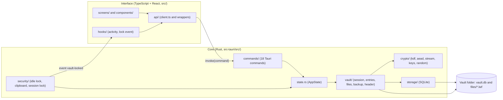
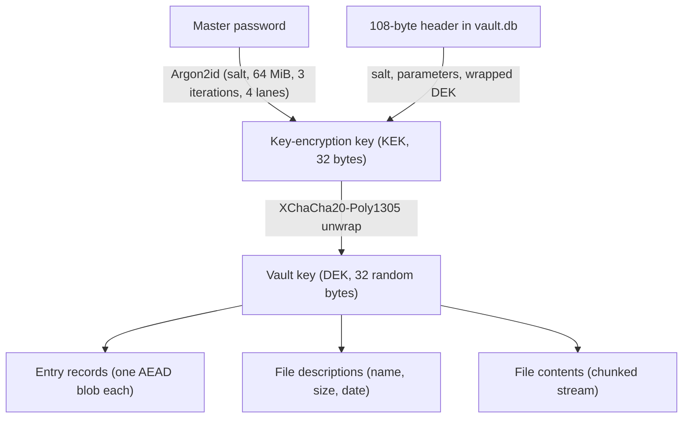
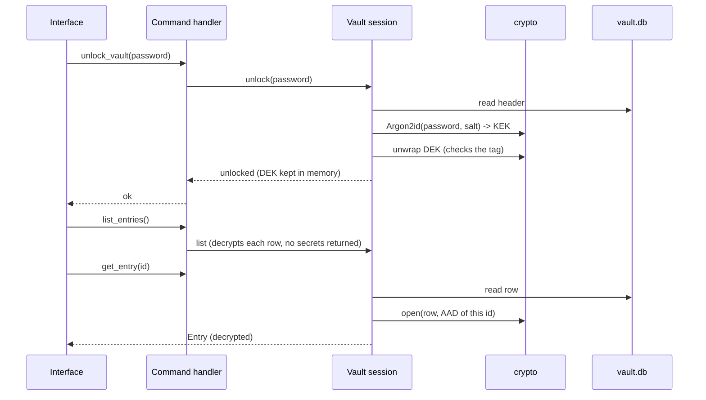
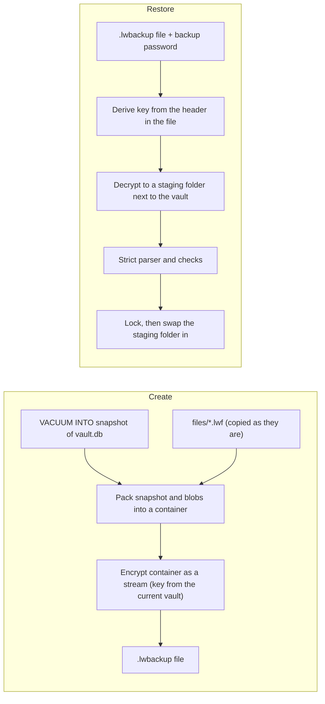
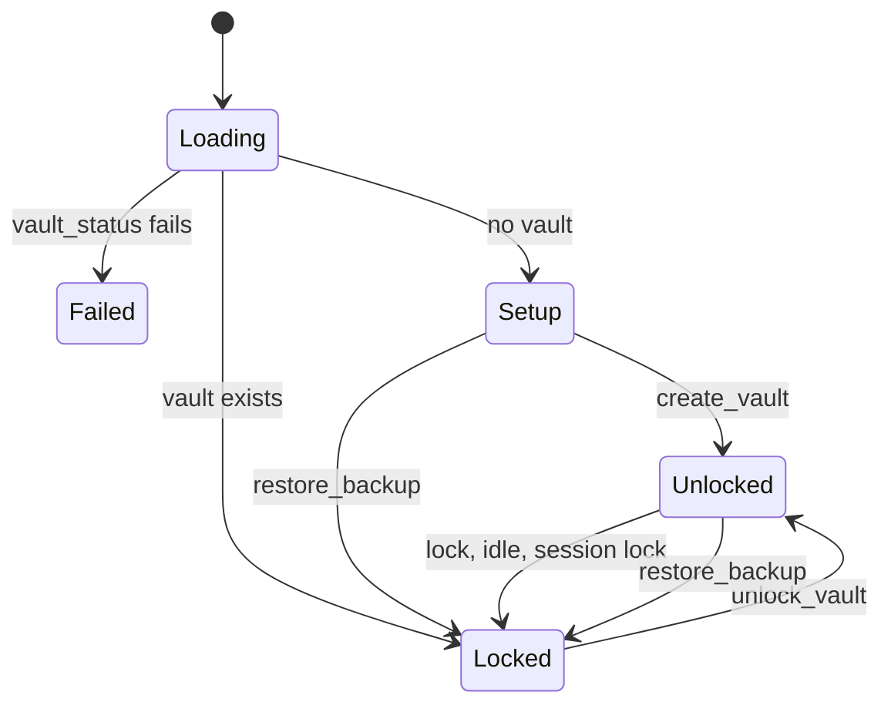

# Architecture

**Purpose:** explain what lockwell is made of, how data flows through it and
why it is designed this way.
**Audience:** contributors, reviewers and anyone who wants to understand the
design before reading the code.

## Table of contents

- [Goal](#goal)
- [Components](#components)
- [Key hierarchy](#key-hierarchy)
- [Data flow](#data-flow)
- [Vault lifecycle](#vault-lifecycle)
- [Interface states](#interface-states)
- [Design decisions](#design-decisions)
- [Related documents](#related-documents)

## Goal

lockwell is a desktop password and file manager that keeps everything in an
encrypted vault on the local disk. The design goals are:

- **Local only.** The core makes no network connections and sends no
  telemetry.
- **Standard cryptography only.** XChaCha20-Poly1305 for encryption and
  Argon2id for key derivation, both from published Rust crates. There is no
  custom cryptographic construction.
- **Small trusted surface.** All secrets live in the Rust core. The interface
  only receives what it needs to display and never receives the master key.
- **Safe failure.** Wrong passwords, tampered data and interrupted writes
  must not corrupt or leak the vault.

## Components

lockwell is a [Tauri 2](https://tauri.app/) application. The Rust core runs
as the application process and the React interface runs inside a WebView.
They communicate only through Tauri commands and one event.

| Component | Location | Responsibility |
| --- | --- | --- |
| Interface | `src/` | Screens, forms and tabs. Holds decrypted data only while a tab that needs it is mounted. |
| API layer | `src/api/` | One typed wrapper per command. `client.ts` converts `{code, message}` errors into `ApiError`. |
| Commands | `src-tauri/src/commands/` | Thin Tauri command handlers. They validate arguments, show native dialogs and call the vault. |
| Application state | `src-tauri/src/state.rs` | Shares the vault, the activity timestamp and the clipboard record between commands and background threads. `with_vault` counts every command as activity. |
| Vault | `src-tauri/src/vault/` | The vault session (create, unlock, lock, change password), entries, files, backup and the key header. |
| Crypto | `src-tauri/src/crypto/` | Argon2id derivation, single-record AEAD, chunked stream encryption, `SecretKey`, randomness. |
| Storage | `src-tauri/src/storage/` | SQLite access. Rows hold only encrypted blobs. |
| Security | `src-tauri/src/security/` | Idle lock watcher, clipboard clearing and the Windows session-lock watcher. |

Every file is described in [`files/`](files/README.md).

## Key hierarchy

The master password never encrypts data directly. It protects a random vault
key, so changing the password re-wraps one key instead of re-encrypting the
vault.

- The header stores the Argon2id parameters, the salt and the wrapped key. The
  first 36 bytes of the header are the associated data of the wrapped key, so
  the parameters and salt cannot be altered without detection.
- A wrong password and a tampered header produce the same error
  (`wrong_password`).
- Each encrypted object is bound to its identity through associated data, so
  a valid blob cannot be moved to another row or file. The exact strings are in
  the [reference](reference.md#associated-data).

## Data flow

### Unlocking and reading an entry

`list_entries` returns summaries (id, title, username, URL, last update). The
password and notes are decrypted only when one entry is requested. Copying a
field uses `copy_entry_field`, which puts the value on the clipboard inside
the core and never returns it to the interface.

### Files

A file is added by choosing it in a native dialog opened by the core. Its
description (name, size, creation time) is one AEAD record in the `files`
table. Its content is written as `files/<id>.lwf`, encrypted in 64 KiB chunks
with the STREAM construction, so memory use stays constant for large files.
Exporting decrypts to a temporary file and renames it over the chosen
destination, so an interrupted export does not leave a half-written file under
the final name.

### Backup and restore

The backup file starts with a clear prefix (magic, version and the vault key
header), followed by the encrypted container. Restoring needs the master
password the vault had when the backup was made. The checks before the swap
verify that the header matches the database header, that every entry and file
description decrypts and that every blob has the right magic. Blob contents
are not decrypted until the file is exported. After a restore the vault is
left locked.

## Vault lifecycle

All locking paths end in `AppState::lock_vault`, which drops the `SecretKey`
(which is wiped on drop), closes the database connection and clears the
clipboard if it still holds a copied secret.

| Trigger | Where | Notice shown on the unlock screen |
| --- | --- | --- |
| Lock button | `lock_vault` command | none |
| 5 minutes without activity | `security/autolock.rs` (checks every 5 seconds) | "locked after 5 minutes of inactivity" |
| Windows session lock | `security/session_lock_windows.rs` | "Windows was locked" |
| Backup restore | `restore_backup` | "Backup restored" |

Both automatic triggers emit the `vault-locked` event with a reason (`idle` or
`systemLock`). The interface also reports keyboard, mouse and touch activity
to the core through `touch_activity`, at most once every 15 seconds.

## Interface states

`src/App.tsx` is a small state machine over the result of `vault_status`.

The unlocked screen has three tabs (Passwords, Files, Settings). Only the
active tab is mounted, so its decrypted state is dropped when the tab changes
and when the vault locks.

## Design decisions

| Decision | Reason |
| --- | --- |
| Random vault key wrapped by a password-derived key | Changing the master password re-wraps 32 bytes instead of re-encrypting everything. |
| One AEAD record per entry and per file description | Tampering or swapping rows is detected, and one record can be changed without touching others. |
| Associated data binds each blob to its id | A valid blob copied to another id fails to decrypt. |
| Chunked STREAM encryption for files and backups | Constant memory for large files, and truncation, reordering or extension is detected. |
| Secrets stay in the core; the clipboard is written by the core | The interface never needs the password of an entry unless the user chooses to reveal it. |
| Everything is a compile-time constant | There is no settings file to tamper with. The trade-off is that timeouts cannot be changed without rebuilding (see [Getting started](getting-started.md#configuration)). |
| Argon2id parameters are validated on every derivation and on decoding a header | A crafted header cannot force an absurd memory or time cost. |
| Strict Content Security Policy and a minimal capability set | The WebView may only listen to events. Dialogs and the clipboard are used from the core. |
| Stage-then-swap for restore, temporary-file-then-rename for writes | A failed restore or export leaves the existing data intact. |

## Related documents

- [Reference](reference.md): commands, errors and formats in detail.
- [Security](security.md): threat model and limits.
- [Development guide](development.md): how to build, test and extend.
