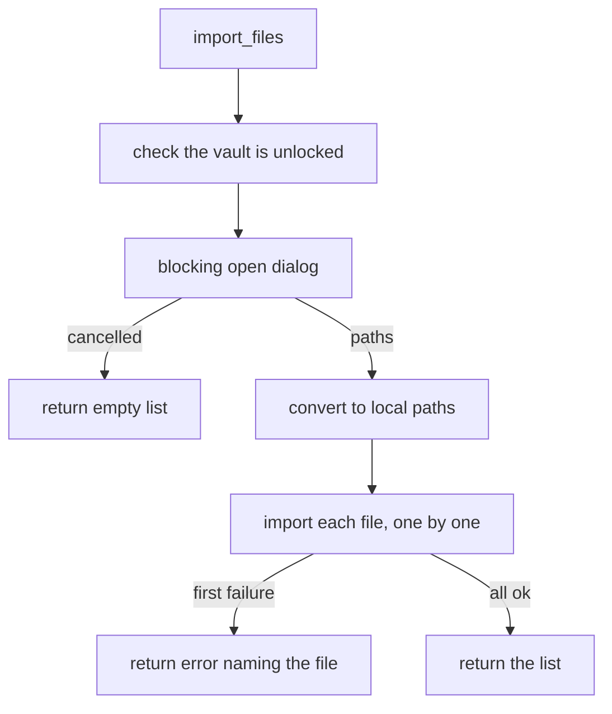

# src-tauri/src/commands/files.rs

## Purpose

Commands to list, add, save a decrypted copy of, and delete encrypted files. The
native open and save dialogs are shown from the core.

## Place in the architecture

Wrappers over [`vault/files.rs`](../vault/files.rs.md) through
[`AppState`](../state.rs.md), with the dialog helpers of
[`dialog.rs`](dialog.rs.md). The interface never handles file system paths: it
only asks for an import or an export, and the core asks the user where. The
interface calls them through `src/api/files.ts`.

## Public API

| Command                                         | Description                                                                              | Errors (`code`)                                              |
| ----------------------------------------------- | ---------------------------------------------------------------------------------------- | ------------------------------------------------------------ |
| `list_files() -> Vec<FileSummary>`              | The stored files.                                                                        | `locked`, `corrupt`.                                         |
| `import_files() -> Vec<FileSummary>` (async)    | Asks the user for files and encrypts them into the vault. An empty list means cancelled. | `locked`, `invalid_input` (names the file), file system or crypto errors. |
| `export_file(id: String) -> bool` (async)       | Asks where to save a decrypted copy and writes it. `false` means cancelled.              | `locked`, `invalid_input`, `not_found`, `corrupt`, `io`.     |
| `delete_file(id: String)`                       | Deletes a stored file.                                                                   | `locked`, `invalid_input`, `not_found`.                      |

`import_files` and `export_file` take the Tauri `AppHandle` and `State`. The
interface sends only the `id` for `export_file`.

Side effects: dialogs are shown. Import writes blobs and rows into the vault.
Export writes a plaintext file outside it.

## Internal structure



- `import_files` checks that the vault is unlocked before showing the dialog.
  Files are imported one by one in the order chosen. The first failure stops the
  rest: files added before it stay in the vault, but the error is returned
  instead of the list. `import_error` prefixes the reason with
  `could not add “<file name>”: `, and uses an empty name for a path without one.
- `export_file` reads the file description first (so an unknown id fails before
  any dialog), suggests the original name in the save dialog, and then exports
  with `overwrite` set to true, because the native save dialog has already asked
  before replacing a file.
- Imports and exports run through `with_vault_blocking`, so file encryption does
  not block the interface.

## Dependencies

- Internal: [`dialog.rs`](dialog.rs.md), [`state.rs`](../state.rs.md),
  [`vault/files.rs`](../vault/files.rs.md) (`FileSummary`), [`error.rs`](../error.rs.md).
- External: `tauri`, `tauri_plugin_dialog` (`DialogExt`).

## Usage example

The dialogs need a window, so the commands were not run end to end. The same
core calls were run against the library, see the usage example in
[`vault/files.rs`](../vault/files.rs.md#usage-example). The error text helper is
covered by its inline tests:

```text
could not add “report.txt”: only regular files can be added
```

## Edge cases, invariants and error handling

- Cancelling a dialog is not an error. It returns an empty list or `false`.
- A partial import is possible: with three files and a failure on the second, the
  first stays imported and the caller gets only the error.
- A file name that is not valid Unicode, a folder, or a path inside the vault
  folder is refused by the vault layer.
- The dialog result must be a local path. Anything else gives `invalid_input`.

## Security

- The exported copy is plaintext on disk, so it leaves the protection of the
  vault. The interface should make that clear to the user.
- Paths come only from native dialogs shown by the core, never from the
  interface.
- Error text names the file, never its content.

## Related files and tests

- Related: [`mod.rs`](mod.rs.md), [`dialog.rs`](dialog.rs.md),
  [`vault/files.rs`](../vault/files.rs.md), [`state.rs`](../state.rs.md).
- Tests: inline `tests` module in
  [`files.rs`](../../../../../src-tauri/src/commands/files.rs): the import error
  text, including a path without a name. Integration tests:
  [`entries_files_flow.rs`](../../../../../src-tauri/tests/entries_files_flow.rs).
