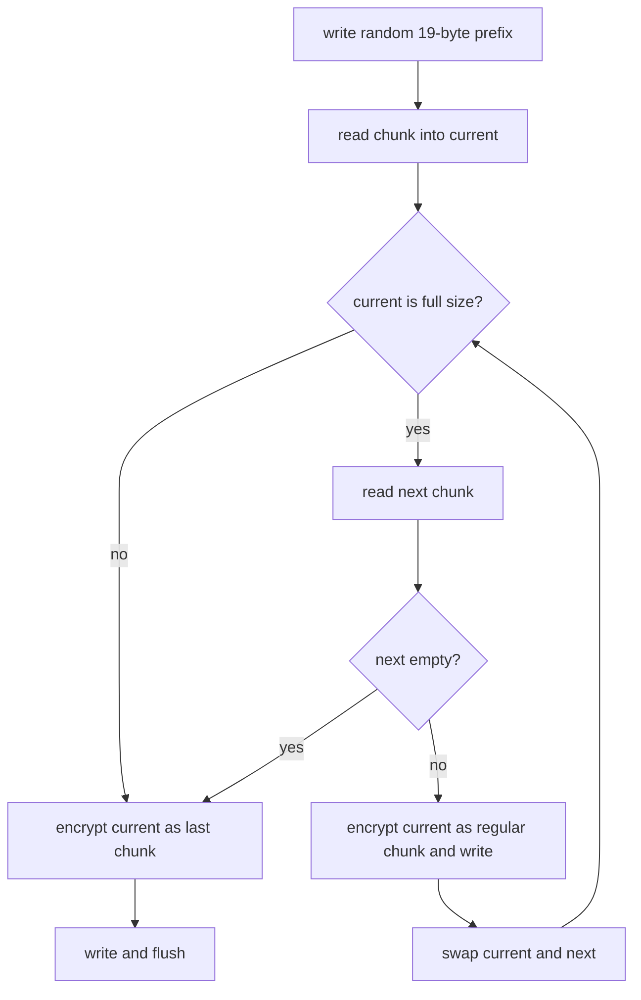

# src-tauri/src/crypto/stream.rs

## Purpose

Encrypts and decrypts data of any size in fixed-size chunks using the STREAM
construction over XChaCha20-Poly1305, with constant memory use.

## Place in the architecture

Files ([`vault/files.rs`](../vault/files.rs.md)) and backups
([`vault/backup.rs`](../vault/backup.rs.md)) go through this module.
Small records use [`aead.rs`](aead.rs.md) instead. The cipher is built with
`aead::cipher`, so both modules share the same primitive.

## Public API

| Item                                                                               | Description                                                            |
| ---------------------------------------------------------------------------------- | ---------------------------------------------------------------------- |
| `CHUNK_LEN: usize = 65536`                                                         | Plaintext bytes per chunk (64 KiB).                                    |
| `NONCE_PREFIX_LEN: usize = 19`                                                     | Random nonce prefix length.                                            |
| `encrypt<R: Read, W: Write>(key, aad, reader, writer) -> Result<u64, CryptoError>` | Encrypts all of `reader` into `writer`. Returns plaintext bytes read.  |
| `decrypt<R: Read, W: Write>(key, aad, reader, writer) -> Result<u64, CryptoError>` | Decrypts a stream from `encrypt`. Returns plaintext bytes written.     |

Parameters: `key: &SecretKey`, `aad: &[u8]` (authenticated with every chunk),
`reader: &mut R`, `writer: &mut W`.

Errors:

- `encrypt`: `Io` (read or write failure), `Random`, `Encryption` (stream
  limits exceeded).
- `decrypt`: `Truncated` (data shorter than the 19-byte prefix, or a last piece
  shorter than a tag), `Decryption` (wrong key, wrong `aad`, or any tampering
  including removed, reordered or appended chunks), `Io`.

Side effects: reads and writes the given streams. Both functions flush the
writer on success. `decrypt` writes plaintext as it goes.

## Internal structure

Layout of the encrypted data:

```text
nonce prefix (19 bytes) || chunk 0 || chunk 1 || ... || last chunk
```

Every chunk except the last holds 65,536 plaintext bytes plus a 16-byte tag.
The last chunk holds 0 to 65,536 bytes plus its tag. STREAM (big-endian 32-bit
counter, from `aead-stream`) authenticates each chunk's position and marks the
last one.



A chunk is held back until the next read shows whether it is the last one,
because STREAM encrypts the final chunk differently. `decrypt` follows the
same loop with chunks of `CHUNK_LEN + 16` bytes. The helpers `read_chunk` and
`read_full` read until the buffer is full or the reader ends, retrying on
`Interrupted` and tolerating short reads. `new_buffer` reserves room for the
tag, so in-place encryption never reallocates and leaves no unwiped copy.
`encrypted_len` is compiled only for tests.

## Dependencies

- Internal: [`aead.rs`](aead.rs.md) (`TAG_LEN`, `cipher`),
  [`keys.rs`](keys.rs.md), [`random.rs`](random.rs.md),
  [`mod.rs`](mod.rs.md).
- External: `aead-stream` (STREAM implementation), `chacha20poly1305`
  (cipher type), `zeroize` (wiped chunk buffers).

## Usage example

Checked by running it against the library:

```rust
use lockwell_lib::crypto::{keys::SecretKey, stream};

let key = SecretKey::generate()?;
let data = vec![7u8; 200_000];
let mut sealed = Vec::new();
let n = stream::encrypt(&key, b"file:abc", &mut &data[..], &mut sealed)?;
// n == 200_000, sealed.len() == 19 + 200_000 + 4 * 16 == 200_083

let mut opened = Vec::new();
stream::decrypt(&key, b"file:abc", &mut &sealed[..], &mut opened)?;
assert_eq!(opened, data);
```

Cutting the sealed data after two full chunks fails with `Decryption`, and the
first chunk (65,536 bytes) has already been written to the output.

## Edge cases, invariants and error handling

- Empty input produces the prefix and one empty last chunk (35 bytes).
- Sizes of 0, 1, 64 KiB minus 1, 64 KiB, 64 KiB plus 1 and several chunks all
  round trip.
- Dropping the last chunk, dropping a middle chunk, reordering, appending
  data and cutting one byte are all rejected.
- Empty input, input shorter than the prefix, or ending in fewer than 16
  bytes after the prefix is `Truncated`.
- Interrupted and short reads are retried. Write failures such as a full disk
  are reported as `Io`.

## Security

- **Partial output on failure:** `decrypt` writes verified chunks before it
  reaches the end. A failure part way leaves earlier plaintext in the
  destination. Callers must write to a temporary destination and discard it on
  error.
- Memory use is constant: two chunk buffers, wiped on drop.
- `aad` binds the stream to its context, for example the id of the file.
- The nonce prefix is random for every stream, so the same input encrypts
  differently each time.

## Related files and tests

- Related: [`aead.rs`](aead.rs.md), [`keys.rs`](keys.rs.md),
  [`random.rs`](random.rs.md), [`vault/files.rs`](../vault/files.rs.md),
  [`vault/backup.rs`](../vault/backup.rs.md).
- Tests: inline `tests` module in
  [`stream.rs`](../../../../../src-tauri/src/crypto/stream.rs): round trips at
  boundary sizes, tampering, reordering, dropping, truncation, appended data,
  interrupted and short reads, and read and write errors.
