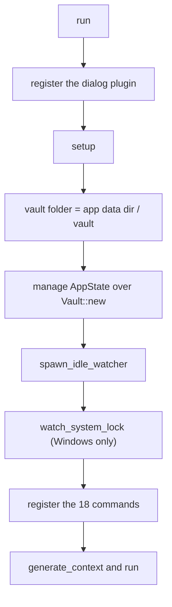

# src-tauri/src/lib.rs

## Purpose

Application entry point of the library crate. It declares the layers and builds
and runs the Tauri application: plugin, shared state, background watchers and the
registered commands.

## Place in the architecture

The desktop binary ([`main.rs`](main.rs.md)) only calls `lockwell_lib::run()`, so
all logic lives in this library. The layers, from the inside out:

| Module                           | Role                                                          |
| -------------------------------- | ------------------------------------------------------------- |
| [`crypto`](crypto/mod.rs.md)     | Wrappers around audited cryptographic crates.                 |
| [`storage`](storage/mod.rs.md)   | The SQLite database that holds encrypted records.             |
| [`vault`](vault/mod.rs.md)       | The vault session, entries, files and backups.                |
| [`state`](state.rs.md), [`security`](security/mod.rs.md) | Shared state, automatic lock and clipboard.   |
| [`commands`](commands/mod.rs.md) | The only functions the interface can call.                    |
| [`error`](error.rs.md)           | The error type shared by the layers.                          |

## Public API

- `pub mod commands`, `crypto`, `error`, `security`, `state`, `storage`, `vault`.
- `pub fn run()`. It builds and runs the Tauri application. It does not return
  under normal use, because it runs the event loop until the app exits.

`run` panics if Tauri fails to start or run (`expect("error while running tauri
application")`), which ends the process. It is marked
`#[cfg_attr(mobile, tauri::mobile_entry_point)]`.

## Internal structure



- `VAULT_DIR = "vault"`: the vault lives in a `vault` folder inside the app data
  directory that Tauri resolves for the app identifier.
- The setup closure creates `AppState::new(Vault::new(vault_dir))`, which uses
  the default Argon2id parameters and the system clipboard.
- `spawn_idle_watcher` starts the inactivity thread. On Windows,
  `watch_system_lock` also starts the session-lock watcher. Any error in setup is
  returned, so the app refuses to start without the lock on session lock rather
  than run unprotected.
- `generate_handler!` registers the commands: five in [`vault`](commands/vault.rs.md),
  five in [`entries`](commands/entries.rs.md), two in
  [`security`](commands/security.rs.md), four in [`files`](commands/files.rs.md)
  and two in [`backup`](commands/backup.rs.md), 18 in total. A command not listed
  here cannot be called by the interface.
- `generate_context!()` embeds `tauri.conf.json`, the capabilities and the icons,
  prepared by [`build.rs`](../build.rs.md).

## Dependencies

- Internal: every module listed above.
- External: `tauri` (the application framework), `tauri-plugin-dialog` (native
  file dialogs, used from the core).

## Usage example

`run` starts a window and the event loop, so it was not called in an automated
check. The desktop binary calls it exactly like this:

```rust
fn main() {
    lockwell_lib::run()
}
```

For development use `npm run tauri dev`. The manual start-up checks are in
[`docs/manual-testing.md`](../../../manual-testing.md).

## Edge cases, invariants and error handling

- A startup failure (for example, the session-lock watcher cannot be created on
  Windows) stops the app with an error instead of running without the protection.
- The vault folder is not created at start. It is created when the user creates a
  vault.
- The 18 names in `generate_handler!` must match the commands defined in
  [`commands/`](commands/mod.rs.md) and the wrappers in `src/api/`.

## Security

- This is where the attack surface is fixed: only the registered commands are
  callable, and the capability file only lets the interface listen for events.
- The app makes no network connections and sends no telemetry. Nothing in this
  file opens a connection.
- Both lock watchers start before the window can be used.

## Related files and tests

- Related: [`main.rs`](main.rs.md), [`state.rs`](state.rs.md),
  [`error.rs`](error.rs.md), [`security/mod.rs`](security/mod.rs.md),
  [`commands/mod.rs`](commands/mod.rs.md), [`build.rs`](../build.rs.md).
- Tests: none inside this file. Starting the application needs a window, so it is
  checked by running the app (see the manual testing guide). The layers it wires
  are tested in their own files and in
  [`src-tauri/tests/`](../../../../src-tauri/tests/).
