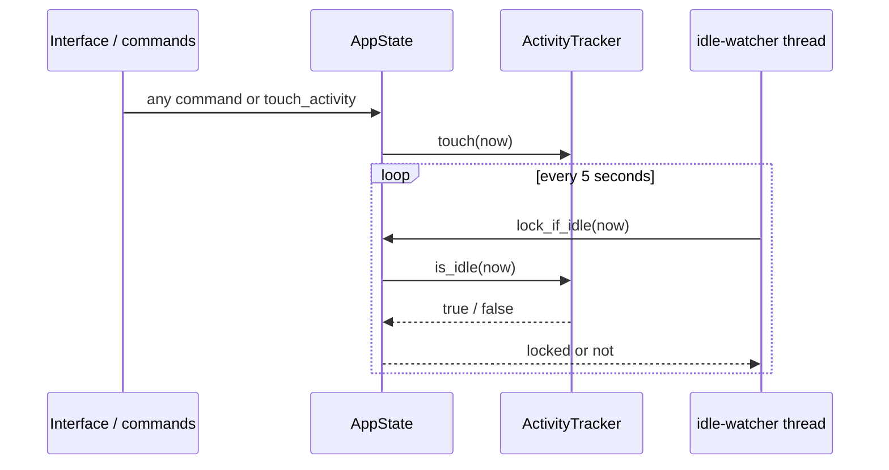

# src-tauri/src/security/autolock.rs

## Purpose

Keeps the clock logic of the automatic lock: when the last user activity
happened and whether the inactivity timeout has passed.

## Place in the architecture

- The module only does arithmetic on instants. It never locks anything by
  itself.
- [`AppState`](../state.rs.md) owns one `ActivityTracker` and updates it on every
  command and on the activity reports from the interface
  ([`commands/security.rs`](../commands/security.rs.md), `touch_activity`).
- The idle watcher thread started by `spawn_idle_watcher` in
  [`mod.rs`](mod.rs.md) calls `AppState::lock_if_idle` every `CHECK_INTERVAL`,
  and that method asks the tracker whether the user is idle.



## Public API

| Item                                                       | Description                                                  |
| ---------------------------------------------------------- | ------------------------------------------------------------ |
| `IDLE_TIMEOUT: Duration = 5 min`                           | The vault locks after this much time without activity.       |
| `CHECK_INTERVAL: Duration = 5 s`                           | How often the watcher checks.                                |
| `struct ActivityTracker`                                   | `Debug, Clone, Copy`. Holds the last activity and the timeout. |
| `ActivityTracker::new(now: Instant, timeout: Duration)`    | A tracker whose last activity is `now`.                      |
| `touch(&mut self, now: Instant)`                           | Records activity at `now`. Earlier times are ignored.        |
| `is_idle(&self, now: Instant) -> bool`                     | `true` when `now` is at or past the deadline.                |

None of the functions returns an error or has side effects beyond the
tracker's own fields.

## Internal structure

Two fields: `last_activity` and `timeout`. `touch` moves `last_activity` only
forward. `is_idle` uses `saturating_duration_since`, so a `now` earlier than the
last activity gives a zero duration instead of a panic, and is never idle.

Time is passed in by the caller instead of read inside the type, so the logic
is tested without waiting.

## Dependencies

- Internal: none. It is used by [`state.rs`](../state.rs.md) and referenced from
  [`mod.rs`](mod.rs.md).
- External: the standard library (`Instant`, `Duration`).

## Usage example

Checked by running it against the library:

```rust
use std::time::{Duration, Instant};
use lockwell_lib::security::autolock::{ActivityTracker, IDLE_TIMEOUT};

let t0 = Instant::now();
let mut tracker = ActivityTracker::new(t0, IDLE_TIMEOUT);
assert!(!tracker.is_idle(t0 + Duration::from_secs(299)));
assert!(tracker.is_idle(t0 + Duration::from_secs(300)));      // the deadline is inclusive
tracker.touch(t0 + Duration::from_secs(240));
tracker.touch(t0);                                            // earlier: ignored
assert!(!tracker.is_idle(t0 + Duration::from_secs(300)));
assert!(tracker.is_idle(t0 + Duration::from_secs(540)));
```

## Edge cases, invariants and error handling

- The deadline is inclusive: exactly `timeout` after the last activity counts
  as idle.
- The last activity never moves backwards, so a late or out-of-order report
  cannot shorten the session.
- A tracker created with a future `now` is not idle for times before it.
- The real lock can be up to `CHECK_INTERVAL` (5 seconds) later than the
  deadline, because the watcher only checks on that interval.
- `Instant` is monotonic, so changes of the system clock do not affect it.

## Security

This is part of the inactivity lock: 5 minutes without activity. A wrong
`touch` call (for example from code that touches on a timer) would keep the
vault unlocked indefinitely, so only user actions and commands should call it.
The tracker holds no secret.

## Related files and tests

- Related: [`mod.rs`](mod.rs.md), [`../state.rs`](../state.rs.md),
  [`commands/security.rs`](../commands/security.rs.md).
- Tests: inline `tests` module in
  [`autolock.rs`](../../../../../src-tauri/src/security/autolock.rs): before and
  at the timeout, activity moving the deadline, and earlier times. The
  `AppState` side is tested in
  [`state.rs`](../../../../../src-tauri/src/state.rs) and in
  [`security.rs`](../../../../../src-tauri/tests/security.rs).
