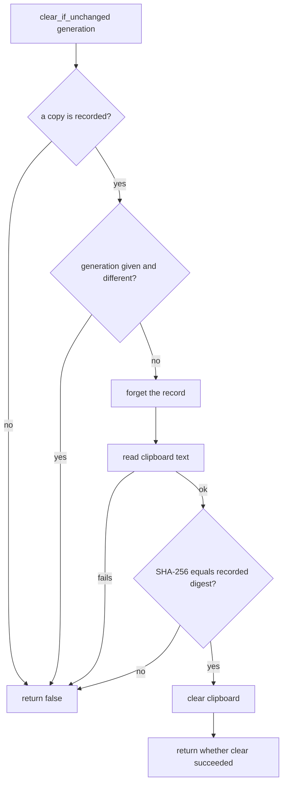

# src-tauri/src/security/clipboard.rs

## Purpose

Copies a secret to the system clipboard and clears it afterwards, but only if
the clipboard still holds what the app copied.

## Place in the architecture

- [`AppState`](../state.rs.md) owns one `SecureClipboard` behind its own mutex.
  [`commands/security.rs`](../commands/security.rs.md) (`copy_entry_field`) copies
  a value through it, and `schedule_clipboard_clear` in [`mod.rs`](mod.rs.md)
  starts the 30-second timer.
- Locking the vault also clears any copied secret (`clear_if_unchanged(None)`),
  from `AppState::lock`.
- The real clipboard sits behind the `ClipboardBackend` trait, so the logic is
  tested with an in-memory clipboard.

## Public API

| Item                                                          | Description                                                                 |
| ------------------------------------------------------------- | --------------------------------------------------------------------------- |
| `CLEAR_AFTER: Duration = 30 s`                                | Time after which a copied secret is cleared.                                |
| `trait ClipboardBackend: Send`                                | `set_text(&mut self, &str)`, `get_text(&mut self)`, `clear(&mut self)`, each returning `Result<_, String>`. |
| `struct SystemClipboard`                                      | The operating system clipboard, through `arboard`.                          |
| `struct SecureClipboard`                                      | Clipboard that remembers a digest of what it copied.                        |
| `SecureClipboard::new(backend: Box<dyn ClipboardBackend>)`    | Wraps a backend.                                                            |
| `copy(&mut self, text: &str) -> AppResult<u64>`               | Copies `text` and returns the generation of this copy.                      |
| `clear_if_unchanged(&mut self, generation: Option<u64>) -> bool` | Clears the clipboard if it still holds the copied secret. Returns whether it cleared. |

Errors: `copy` returns `AppError::Io("the clipboard is not available")` when the
backend fails. The message never includes the text. `clear_if_unchanged` does
not return errors. Any failure to read or clear gives `false`.

Side effects: `copy` and `clear_if_unchanged` read and write the real clipboard
when the backend is `SystemClipboard`.

## Internal structure



- `copy` writes the text, increments a generation counter and records
  `Copied { digest, generation }`. Only the SHA-256 digest is kept, never the
  text, so the secret is not held in memory by this type.
- A timer holds the generation of its own copy. `Some(generation)` clears only
  that copy, so a timer from an older copy does nothing once a newer one
  exists. `None` (used when the vault locks) clears any copied secret.
- The record is forgotten before the clipboard is read. A mismatch or a failed
  clear is therefore reported and not retried.
- The text read back for comparison is held in a `Zeroizing` string.
- `SystemClipboard` opens a new `arboard::Clipboard` for every operation. On
  Windows it uses `exclude_from_monitoring`, so the text stays out of the
  clipboard history (Win+V) and cloud clipboard sync.

## Dependencies

- Internal: [`error.rs`](../error.rs.md) (`AppError`, `AppResult`).
- External: `arboard` (system clipboard), `sha2` (digest for the comparison),
  `zeroize` (wiping the text read back).

## Usage example

Checked by running it against the library with an in-memory backend:

```rust
use lockwell_lib::security::clipboard::{ClipboardBackend, SecureClipboard};

// `Mem` implements ClipboardBackend over an Arc<Mutex<Option<String>>>.
let mut clipboard = SecureClipboard::new(Box::new(mem.clone()));
let first = clipboard.copy("secret-one")?;        // generation 1
let second = clipboard.copy("secret-two")?;       // generation 2
assert!(!clipboard.clear_if_unchanged(Some(first)));   // old timer: nothing happens
// the user copies something else:
//   clipboard.clear_if_unchanged(Some(second)) == false and the text stays
clipboard.copy("again")?;
assert!(clipboard.clear_if_unchanged(None));      // lock: cleared
```

## Edge cases, invariants and error handling

- If the user copied something else since, that content is left alone.
- Text that is not on the clipboard any more (or non-text content) is left
  alone and gives `false`.
- Clearing happens once per copy. A second call for the same generation returns
  `false`, even if the same text was copied again by the user.
- Generations strictly increase with every copy.
- A clipboard that is unavailable makes `copy` fail and `clear_if_unchanged`
  return `false`.
- A clipboard whose `clear` fails keeps the secret. The failure is reported as
  `false` and is not retried.

## Security

- Known limits, stated in the source: other programs can read the clipboard
  while the secret is on it, and only text copied by this app is cleared.
- **Observation, not fixed:** nothing clears the clipboard when the application
  exits. The 30-second timer is a thread of the process, so closing the app
  before it fires leaves the copied secret on the clipboard. No exit or
  window-close handler exists in the code.
- Comparing digests avoids keeping the secret in memory for the comparison.
- Error messages never contain the secret. A test covers it.

## Related files and tests

- Related: [`mod.rs`](mod.rs.md), [`../state.rs`](../state.rs.md),
  [`commands/security.rs`](../commands/security.rs.md), [`error.rs`](../error.rs.md).
- Tests: inline `tests` module in
  [`clipboard.rs`](../../../../../src-tauri/src/security/clipboard.rs). It
  exports `FakeClipboard`, which the tests of `state.rs` and
  `commands/security.rs` also use. Covers copying, own-copy clearing, user
  content left alone, older timers, lock clearing, non-text content, failures
  and the absence of the secret in errors. Integration tests:
  [`security.rs`](../../../../../src-tauri/tests/security.rs).
