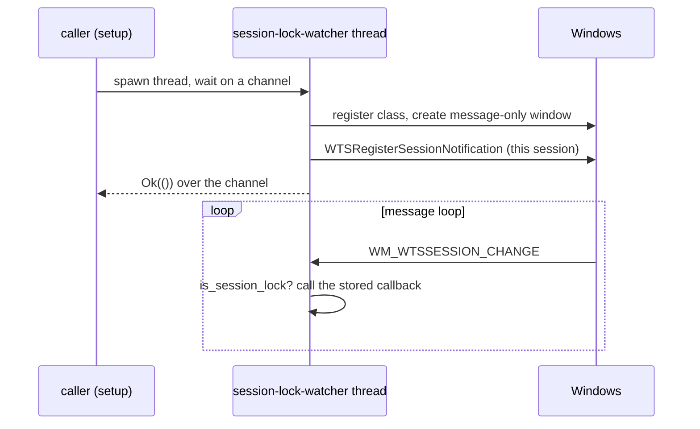

# src-tauri/src/security/session_lock_windows.rs

## Purpose

Windows only. Detects when the Windows session is locked (Win+L, the lock
screen or a user switch) and calls a callback.

## Place in the architecture

- Compiled only on Windows (`#[cfg(windows)]` in [`mod.rs`](mod.rs.md)).
- `watch_system_lock` in [`mod.rs`](mod.rs.md) passes a callback that locks the
  vault through [`AppState`](../state.rs.md) and notifies the interface with
  `LockReason::SystemLock`. [`lib.rs`](../lib.rs.md) starts it during setup and
  refuses to start the app if it fails, because the lock on session lock is a
  security requirement.
- It contains the only `unsafe` code of the crate: calls to the Win32 API. Each
  `unsafe` block states why it is sound.

## Public API

`watch(on_lock: impl Fn() + Send + Sync + 'static) -> Result<(), String>`

- Starts watching and calls `on_lock` for each session lock.
- Errors, as text: the watcher was already started (`"the session lock watcher
  is already running"`); the thread cannot start; the window class cannot be
  registered; the window cannot be created or registered for notifications;
  or the watcher stopped before reporting that it was ready.
- Side effects: starts a thread named `session-lock-watcher`, registers a
  window class and creates a hidden message-only window.

## Internal structure



- The callback is stored in a process-wide `OnceLock`, because a window
  procedure cannot capture state. A second call to `watch` fails.
- `watch` returns only after the thread reports that the window was created and
  registered, so a setup failure reaches the caller.
- `create_notification_window` makes a message-only window (`HWND_MESSAGE`) and
  registers it with `NOTIFY_FOR_THIS_SESSION`.
- `run_message_loop` pumps messages until `GetMessageW` returns 0 or -1. The
  thread stays there for the rest of the process.
- `window_procedure` calls the callback when `is_session_lock` is true and hands
  every other message to `DefWindowProcW`.
- `is_session_lock` is true only for `WM_WTSSESSION_CHANGE` with
  `WTS_SESSION_LOCK`. Unlock and other session events do nothing.

## Dependencies

- Internal: none directly. It is wired up from [`mod.rs`](mod.rs.md).
- External: the `windows` crate (Win32 bindings) with the features listed in
  `Cargo.toml`: foundation, window and messaging, remote desktop and library
  loading.

## Usage example

Checked by running it in a Windows process:

```rust
use lockwell_lib::security::session_lock_windows::watch;

assert_eq!(watch(|| println!("session locked")), Ok(()));
assert_eq!(
    watch(|| {}),
    Err("the session lock watcher is already running".to_string())
);
```

The callback itself cannot be triggered by an automated check without locking
the machine, so a real lock was not simulated.

## Edge cases, invariants and error handling

- Only one watcher can run per process.
- Only lock events trigger the callback. Unlocking does nothing, because the
  vault stays locked until the user unlocks it with the password.
- The callback runs on the watcher thread, inside the window procedure. It must
  return quickly and must not panic.
- The thread has no stop mechanism. It runs for the life of the process.
- A failure to start is returned to the caller, which prevents the app from
  running without the protection.

## Security

- This is the "lock when Windows locks" requirement. The watcher locks the vault
  and the callback also clears a copied secret through the state.
- Only sessions of the current user session are watched
  (`NOTIFY_FOR_THIS_SESSION`).
- Unsafe code is limited to this file and each block states its invariant. The
  window class name and procedure are static, and the message passed to
  `DefWindowProcW` is forwarded unmodified.

## Related files and tests

- Related: [`mod.rs`](mod.rs.md), [`../state.rs`](../state.rs.md),
  [`lib.rs`](../lib.rs.md).
- Tests: inline `tests` module in
  [`session_lock_windows.rs`](../../../../../src-tauri/src/security/session_lock_windows.rs):
  the message filter accepts only lock messages. The lock itself needs manual
  verification, see [`docs/manual-testing.md`](../../../../manual-testing.md).
