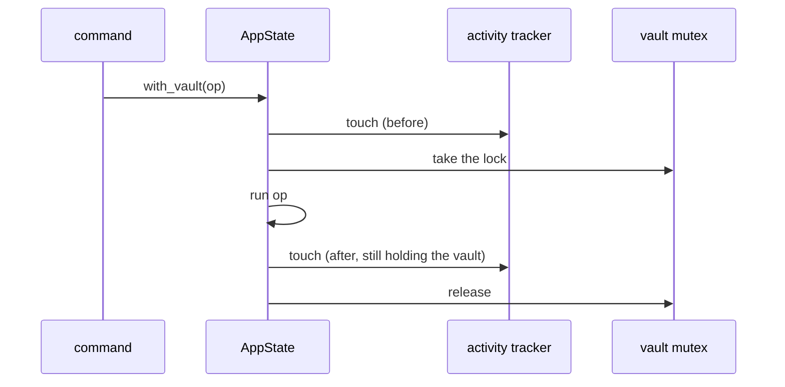

# src-tauri/src/state.rs

## Purpose

Application state shared by the Tauri commands and the background watchers: the
vault, the time of the last user activity and the clipboard.

## Place in the architecture

- Tauri manages one `AppState` ([`lib.rs`](lib.rs.md)). Every command reaches the
  vault through it ([`commands/`](commands/mod.rs.md)), and the idle watcher, the
  session-lock watcher and the clipboard timer call into it
  ([`security/mod.rs`](security/mod.rs.md)).
- Every way of locking the vault (the command, the inactivity timer and the
  Windows session lock) goes through `AppState::lock_vault`, so the clipboard is
  cleared and the vault is wiped in one place.
- Each part sits behind its own mutex. No code holds the clipboard mutex while
  taking the vault one, so they cannot deadlock. When both the vault and the
  activity mutex are needed, the vault is taken first.

## Public API

`AppState` is `Clone`. Clones share the same three `Arc<Mutex<_>>`.

| Item                                                                   | Description                                                                    |
| ---------------------------------------------------------------------- | ------------------------------------------------------------------------------ |
| `AppState::new(vault: Vault)`                                          | State over the vault and the system clipboard.                                 |
| `AppState::with_clipboard(vault, clipboard: Box<dyn ClipboardBackend>)` | State over a given clipboard backend (tests use an in-memory one).            |
| `with_vault<T>(&self, op: impl FnOnce(&mut Vault) -> AppResult<T>) -> AppResult<T>` | Runs `op` with exclusive access to the vault.                     |
| `async with_vault_blocking<T, F>(&self, op: F) -> AppResult<T>`        | Runs a slow `op` on a blocking thread.                                         |
| `touch(&self)`                                                         | Records user activity now.                                                     |
| `lock(&self) -> bool`                                                  | Locks the vault and clears a secret this app left on the clipboard. Returns whether the vault was unlocked. |
| `lock_if_idle(&self, now: Instant) -> bool`                            | Locks only if the user has been idle as of `now`. Returns whether it locked.   |
| `copy_secret(&self, text: &str) -> AppResult<u64>`                     | Copies a secret and returns its generation.                                    |
| `clear_clipboard_if_unchanged(&self, generation: u64) -> bool`         | Clears that copy if the clipboard still holds it.                              |

Errors: `with_vault` returns the error of the operation. `with_vault_blocking`
also returns `AppError::Io("background task failed")` if the blocking thread could
not run it. `copy_secret` returns `AppError::Io("the clipboard is not available")`
if the clipboard cannot be written.

Side effects: `lock` and `lock_if_idle` drop the key and the database connection,
and clear the clipboard if it holds the copied secret.

## Internal structure



- Every command counts as user activity twice: before the operation and after it,
  while still holding the vault. A long operation (key derivation, encrypting a
  large file) therefore does not trigger the automatic lock as soon as it ends,
  and an idle check that was waiting for the vault sees the activity.
- `lock_vault` takes the vault, and if given a time it checks the tracker while
  holding it. It locks, releases the vault, then clears the clipboard. Because the
  idle check runs after the vault is free, it never locks in the middle of an
  operation.
- `with_vault_blocking` clones the state and runs `with_vault` inside
  `spawn_blocking`, so key derivation and file encryption do not block the
  interface.
- The private `lock` helper recovers a poisoned mutex with `into_inner`. A panic
  while holding it cannot leave the state half updated in a way that matters,
  because database writes are transactional, so recovering is better than failing
  forever.

## Dependencies

- Internal: [`error.rs`](error.rs.md), [`security/autolock.rs`](security/autolock.rs.md),
  [`security/clipboard.rs`](security/clipboard.rs.md),
  [`vault/session.rs`](vault/session.rs.md) (`Vault`).
- External: `tauri` (`async_runtime::spawn_blocking`).

## Usage example

Checked by running it against the library:

```rust
let state = AppState::new(Vault::with_kdf(dir.join("vault"), kdf_params));
state.with_vault(|v| v.create("correct horse battery"))?;
let now = Instant::now();
assert!(!state.lock_if_idle(now));                                         // not idle yet
assert!(state.lock_if_idle(now + IDLE_TIMEOUT + Duration::from_secs(1)));  // locked
assert!(!state.lock());                                                    // already locked
```

## Edge cases, invariants and error handling

- `lock` and `lock_if_idle` return `false` if the vault was already locked, so a
  caller notifies the interface only when something changed.
- `lock_if_idle` does nothing when the user has been active. An operation that was
  running counts as activity when it ends.
- A panic inside an operation does not block the vault: the poisoned mutex is
  recovered and the vault can still be locked.
- A user copy made after the app's copy is not erased by locking.

## Security

- Locking wipes the key (the `UnlockedVault` is dropped) and clears the clipboard
  in one place, so no path locks without clearing.
- The activity tracker should be touched only by commands and by real user
  actions. Anything else would postpone the inactivity lock.
- The state holds no secret itself. The key lives in the `Vault`, and the
  clipboard keeps only a digest of what it copied.

## Related files and tests

- Related: [`lib.rs`](lib.rs.md), [`security/mod.rs`](security/mod.rs.md),
  [`security/autolock.rs`](security/autolock.rs.md),
  [`security/clipboard.rs`](security/clipboard.rs.md),
  [`vault/session.rs`](vault/session.rs.md),
  [`commands/mod.rs`](commands/mod.rs.md).
- Tests: inline `tests` module in
  [`state.rs`](../../../../src-tauri/src/state.rs): operation results, blocking
  execution, lock and clipboard clearing, the idle lock, a long operation
  postponing the idle lock, panic recovery and copy errors. Integration tests:
  [`security.rs`](../../../../src-tauri/tests/security.rs).
