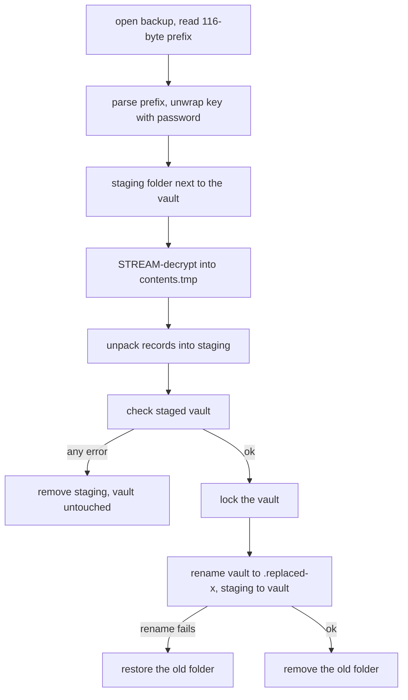

# src-tauri/src/vault/backup.rs

## Purpose

Creates an encrypted backup of the whole vault and restores one, replacing the
vault only after the backup has been fully decrypted and checked.

## Place in the architecture

- `create_backup` is a method of `UnlockedVault` and `restore_backup` a method
  of `Vault` ([`session.rs`](session.rs.md)). The commands in
  [`commands/backup.rs`](../commands/backup.rs.md) call them.
- The backup carries the vault's own key header, so it opens with the master
  password the vault had when the backup was made, not the current one.
- The backup file, the database snapshot and the staging folder only ever hold
  encrypted data.

## Public API

| Item                                                                 | Description                                                              |
| -------------------------------------------------------------------- | ------------------------------------------------------------------------ |
| `BACKUP_EXTENSION = "lwbackup"`                                      | Extension of backup files.                                               |
| `BACKUP_FORMAT_VERSION: u32 = 1`                                     | Version of the backup format.                                            |
| `UnlockedVault::create_backup(&self, destination: &Path) -> AppResult<()>` | Writes the backup.                                                 |
| `Vault::restore_backup(&mut self, backup: &Path, password: &str) -> AppResult<()>` | Replaces the vault with the backup. Leaves it locked.        |

Errors:

- `create_backup`: `InvalidInput` if the destination is inside the vault;
  `Corrupt("a stored file is missing")`; file system, storage or crypto errors.
  On error no backup file is left behind.
- `restore_backup`: `WrongPasswordOrCorrupt` for a wrong password; `Corrupt` if
  the file is not a valid, intact backup; `UnsupportedVersion` for a newer
  format; `InvalidInput` if the backup is not a file or is inside the vault
  folder. On any error the vault folder is left as it was. If the failure
  happens while swapping the folders, the session has already been locked.

Side effects: `create_backup` writes a temporary snapshot in the vault folder
and removes it afterwards. `restore_backup` creates sibling folders of the
vault folder, locks the vault and may take a long time on large vaults.

## Internal structure

Backup file layout:

```text
magic "LWBK" (4) | format version u32 (4) | vault key header (108)
| STREAM-encrypted contents
```

The contents are encrypted with the vault key and authenticated with the whole
clear prefix as associated data (`lockwell:backup:v1:` plus the prefix).
Decrypted, the contents are a container:

```text
"LWBC" | record* | 0x00
record = kind u8 (1 database, 2 file blob) | name length u16 | name
         | data length u64 | data
```

Numbers are little-endian. The database is a consistent snapshot made with
`VACUUM INTO`. File blobs are copied as they are, already encrypted.



Pieces:

- `create_backup` snapshots the database, builds a `Concat` reader over the
  container pieces (so nothing is loaded whole) and writes with
  `write_atomically` ([`files.rs`](files.rs.md)). A file that grows while read
  is cut at the length recorded for it.
- `unpack_contents` treats the container as untrusted even though it is
  authenticated. It accepts one database record named `vault.db` and blob
  records named `<generated id>.lwf`, each name once, writes each with
  `create_new`, rejects unknown kinds, and requires the end marker with nothing
  after it.
- `check_staged_vault` opens the staged database. The header in it must equal
  the one in the backup prefix. Every entry and file description must decrypt,
  and each listed file must have its blob with the right magic. Blob contents
  are not decrypted here. That happens when the file is exported.
- `swap_in` keeps the old vault until the new one is in place and puts it back
  if the second rename fails.

## Dependencies

- Internal: [`files.rs`](files.rs.md), [`header.rs`](header.rs.md),
  [`session.rs`](session.rs.md), [`mod.rs`](mod.rs.md),
  [`crypto/stream.rs`](../crypto/stream.rs.md), [`crypto/keys.rs`](../crypto/keys.rs.md),
  [`crypto/random.rs`](../crypto/random.rs.md), [`storage/db.rs`](../storage/db.rs.md),
  [`error.rs`](../error.rs.md).
- External: the standard library only. The snapshot uses SQLite through
  `rusqlite`.

## Usage example

Checked by running it against the library:

```rust
let unlocked = vault.unlocked()?;
unlocked.create_backup(&backup_path)?;          // 16,655 bytes for one entry and one 10-byte file
// a destination inside the vault folder:
//   Err(InvalidInput("files inside the vault folder cannot be used"))

vault.change_master_password("correct horse battery", "another long password")?;
// the backup still needs the password it was made under:
//   vault.restore_backup(&backup_path, "another long password") == Err(WrongPasswordOrCorrupt)
vault.restore_backup(&backup_path, "correct horse battery")?;
// vault.status() == { exists: true, unlocked: false }
vault.unlock("correct horse battery")?;
```

After the restore, no `.restoring-*` or `.replaced-*` folder remains next to
the vault folder.

## Edge cases, invariants and error handling

- A restore into a vault folder that does not exist yet (a new computer) works:
  the staging folder is simply renamed into place.
- The vault folder needs a parent folder, because the staging folders are
  created next to it on the same volume.
- A tampered prefix, a damaged or truncated stream, an unexpected record, a
  missing file or a header that does not match the database are all rejected
  before anything is replaced.
- Stale `*.snapshot-*`, `*.restoring-*` and `*.replaced-*` names are only
  removed by the operation that made them. If the process is killed part way,
  they stay on disk and nothing removes them later. They hold only encrypted
  data.
- Restoring an old backup brings back the old master password and the data of
  that moment.

## Security

- A backup is as private as the master password it was made under.
- All files written during backup and restore contain only encrypted data.
  `contents.tmp` inside the staging folder is the decrypted container, which is
  still ciphertext for the records and files.
- The staged check holds a clone of the vault key, which is wiped when it is
  dropped.
- The backup path and the vault path are separate: a backup inside the vault
  folder is refused, so the vault never contains its own backup.

## Related files and tests

- Related: [`files.rs`](files.rs.md), [`header.rs`](header.rs.md),
  [`session.rs`](session.rs.md), [`commands/backup.rs`](../commands/backup.rs.md),
  [`crypto/stream.rs`](../crypto/stream.rs.md).
- Tests: inline `tests` module in
  [`backup.rs`](../../../../../src-tauri/src/vault/backup.rs): restore of
  entries and files, restore on a new computer, password at backup time, wrong
  password, damaged and tampered backups, other files and newer versions,
  encryption of the backup, the container parser and the staged check.
  Integration tests:
  [`backup_flow.rs`](../../../../../src-tauri/tests/backup_flow.rs).
