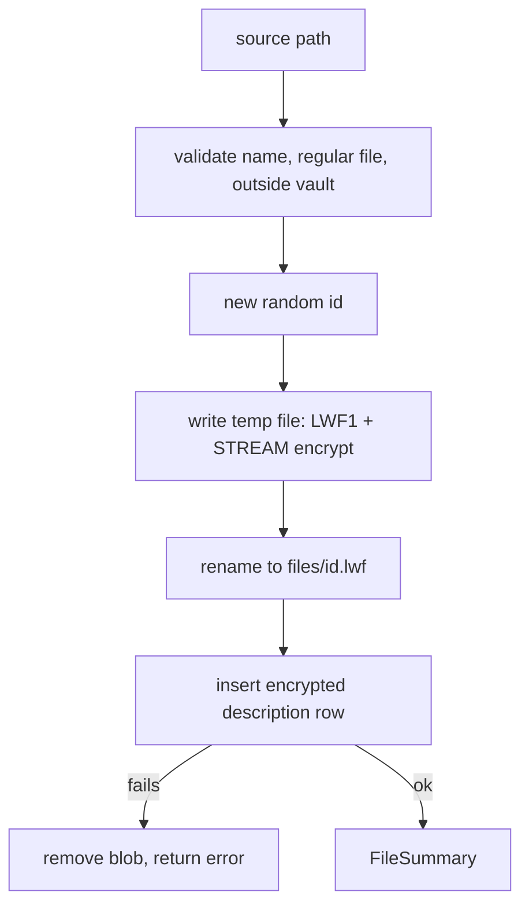

# src-tauri/src/vault/files.rs

## Purpose

Encrypted files: importing a file from disk into the vault, listing, exporting
back to disk and deleting. It also provides the path checks and the atomic
write helper used by backups.

## Place in the architecture

Adds methods to `UnlockedVault` ([`session.rs`](session.rs.md)), called by
[`commands/files.rs`](../commands/files.rs.md). Each stored file has two parts:

- a row in the `files` table with its description (name, size, import time) as
  JSON encrypted with the vault key, bound to the file id;
- a blob `files/<id>.lwf` in the vault folder: the magic `LWF1` followed by the
  content encrypted with STREAM ([`crypto/stream.rs`](../crypto/stream.rs.md)),
  bound to the file id.

The blob name is the random id, so neither the name nor the type of the file is
visible on disk. Writes go to a temporary file that is renamed when complete.

## Public API

| Item                                                      | Description                                                         |
| --------------------------------------------------------- | ------------------------------------------------------------------- |
| `MAX_FILE_NAME_CHARS: usize = 255`                        | Maximum file name length, in characters.                            |
| `struct FileSummary { id, name, size, created_at }`       | `Serialize`, camelCase. `size` in bytes, `created_at` in milliseconds. |
| `validate_file_name(name: &str) -> AppResult<()>`         | Not empty or blank, at most 255 characters, no control characters, no `/` or `\`. `InvalidInput` otherwise. |

Methods of `UnlockedVault`:

| Method                                                    | Description                                                | Errors                                                                           |
| --------------------------------------------------------- | ---------------------------------------------------------- | -------------------------------------------------------------------------------- |
| `list_files() -> AppResult<Vec<FileSummary>>`             | All files sorted by name, case-insensitive, ties by id.    | `Corrupt` if a description fails to decrypt.                                     |
| `get_file(id) -> AppResult<FileSummary>`                  | One description.                                           | `InvalidInput` (malformed id), `NotFound`, `Corrupt`.                            |
| `import_file(source: &Path) -> AppResult<FileSummary>`    | Encrypts a file into the vault, streaming.                 | `InvalidInput` (not a regular file, inside the vault folder, bad name), file system, storage or crypto errors. |
| `export_file(id, destination: &Path, overwrite: bool) -> AppResult<()>` | Decrypts to `destination`.                   | `InvalidInput`, `NotFound`, `Corrupt` (blob missing or fails to decrypt).        |
| `delete_file(id) -> AppResult<()>`                        | Deletes the blob and the description.                      | `InvalidInput`, `NotFound`.                                                      |

Crate-visible: `BLOB_MAGIC`, `BLOB_EXTENSION`, `blob_file_name(id)`,
`check_outside_folder(folder, path)`, `UnlockedVault::check_outside_vault(path)`
and `write_atomically(target, write)`. [`backup.rs`](backup.rs.md) uses them.

## Internal structure

Import:



- `write_atomically` creates `.lockwell-<16 hex digits>.tmp` next to the target
  with `create_new`, runs the writer, flushes and calls `sync_all`, then renames
  over the target. On error it removes the temporary file. The fixed-length
  name stays valid whatever the length of the target name. An existing target is
  replaced, so callers decide beforehand whether overwriting is allowed.
- `export_file` checks the destination (exists, is a folder, inside the vault),
  opens the blob, verifies the magic and decrypts into a temporary file that is
  renamed only after full authentication. It then compares the written size to
  the description. A mismatch removes the destination and returns `Corrupt`.
- `check_outside_folder` resolves both paths with `canonicalize`, so `..`
  segments and symbolic links cannot reach the folder. If `path` does not exist,
  its parent is resolved instead.
- Associated data: descriptions use `lockwell:file:v1:<id>` and blobs use
  `lockwell:file-data:v1:<id>`. They differ, so a description cannot stand in
  for content.
- `delete_file` tolerates a blob that is already missing and then deletes the
  row.

## Dependencies

- Internal: [`session.rs`](session.rs.md), [`entries.rs`](entries.rs.md)
  (`check_id`), [`mod.rs`](mod.rs.md), [`crypto/aead.rs`](../crypto/aead.rs.md),
  [`crypto/stream.rs`](../crypto/stream.rs.md), [`crypto/random.rs`](../crypto/random.rs.md),
  [`storage/db.rs`](../storage/db.rs.md), [`error.rs`](../error.rs.md).
- External: `serde` and `serde_json`, `zeroize` (JSON buffer of descriptions).

## Usage example

Checked by running it against the library:

```rust
let unlocked = vault.unlocked()?;
let file = unlocked.import_file(&source)?;        // note.txt, 10 bytes
// the blob on disk is "<32 hex digits>.lwf" (36 characters)
unlocked.export_file(&file.id, &out, false)?;     // out contains the original bytes
// export again without overwrite:
//   Err(InvalidInput("a file with that name already exists"))
// importing the vault's own database:
//   Err(InvalidInput("files inside the vault folder cannot be used"))
```

## Edge cases, invariants and error handling

- Importing validates the file name taken from the path. The name must be valid
  Unicode.
- On an import error nothing is left in the vault. If storing the description
  fails, the blob is removed.
- `export_file` refuses a folder as destination even when `overwrite` is true.
  A destination whose parent folder does not exist is refused.
- Empty files, files that are exact multiples of the chunk size and large files
  round trip.
- A missing blob is `Corrupt("the encrypted file is missing")`. A damaged,
  truncated, swapped or foreign blob is `Corrupt`, and nothing is written to the
  destination.
- A single bad description makes `list_files` fail as a whole.
- `delete_file` removes the blob with an ordinary delete. It does not overwrite
  it. The content is encrypted, so the leftover bytes are ciphertext.

## Security

- Paths from the user are never trusted: files inside the vault folder cannot
  be imported or overwritten, identifiers are validated before they build a
  path, and names cannot contain separators.
- The path check and the later file operation are separate steps. A path that
  changes between them is not protected against.
- Export writes plaintext to the destination the user chooses, outside the
  vault. Protecting that copy is up to the user.
- Plaintext chunks are held only in wiped buffers during encryption and
  decryption.

## Related files and tests

- Related: [`session.rs`](session.rs.md), [`backup.rs`](backup.rs.md),
  [`entries.rs`](entries.rs.md), [`commands/files.rs`](../commands/files.rs.md),
  [`crypto/stream.rs`](../crypto/stream.rs.md).
- Tests: inline `tests` module in
  [`files.rs`](../../../../../src-tauri/src/vault/files.rs): round trips,
  encryption of names and content on disk, Unicode names, sorting, overwrite
  rules, damaged, swapped, missing and truncated blobs, path and name checks,
  and atomic writes. Integration tests:
  [`entries_files_flow.rs`](../../../../../src-tauri/tests/entries_files_flow.rs).
