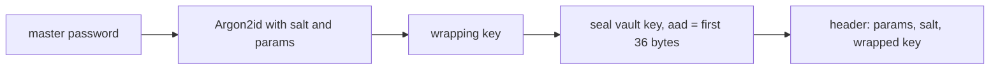

# src-tauri/src/vault/header.rs

## Purpose

Defines the vault key header: the Argon2id parameters, the salt and the vault
key wrapped (encrypted) with a key derived from the master password.

## Place in the architecture

- The vault key (data encryption key) is random and encrypts every record and
  file. The master password only derives a wrapping key (key encryption key)
  that protects the vault key.
- Changing the master password therefore re-wraps the same vault key. No entry
  or file is re-encrypted.
- The header is stored in the `meta` table by [`session.rs`](session.rs.md) and
  copied into the prefix of every backup by [`backup.rs`](backup.rs.md).

## Public API

| Item                                                                          | Description                                                                                    |
| ----------------------------------------------------------------------------- | ---------------------------------------------------------------------------------------------- |
| `FORMAT_VERSION: u32 = 1`                                                     | Version of the header format.                                                                  |
| `HEADER_LEN: usize = 108`                                                     | Length of an encoded header.                                                                   |
| `struct VaultHeader`                                                          | Decoded header (`Debug, Clone, PartialEq, Eq`). Fields are private.                            |
| `VaultHeader::create(password: &[u8], kdf: KdfParams) -> AppResult<(VaultHeader, SecretKey)>` | Generates a new vault key and wraps it.                                        |
| `VaultHeader::wrap(vault_key: &SecretKey, password: &[u8], kdf: KdfParams) -> AppResult<VaultHeader>` | Wraps an existing key with a fresh salt. Used to change the password.   |
| `VaultHeader::unwrap_key(&self, password: &[u8]) -> AppResult<SecretKey>`     | Recovers the vault key.                                                                        |
| `VaultHeader::to_bytes(&self) -> Vec<u8>`                                     | Encodes the header (108 bytes).                                                                |
| `VaultHeader::from_bytes(bytes: &[u8]) -> AppResult<VaultHeader>`             | Decodes and validates a header.                                                                |

Errors:

- `create` and `wrap`: random, key derivation or encryption failures (see
  [`crypto/mod.rs`](../crypto/mod.rs.md)).
- `unwrap_key`: `WrongPasswordOrCorrupt` if the password is wrong or the header
  was modified (the same error for both). Key derivation errors are passed on.
- `from_bytes`: `UnsupportedVersion` for a newer format version; `Corrupt` for
  anything else invalid.

Side effects: key derivation is slow and uses memory (see
[`crypto/kdf.rs`](../crypto/kdf.rs.md)).

## Internal structure

Binary layout, little-endian, 108 bytes:

```text
magic "LWVH" (4) | format version u32 (4) | memory KiB u32 (4)
| iterations u32 (4) | parallelism u32 (4) | salt (16)
| wrapped key: nonce (24) + encrypted vault key (32) + tag (16)
```

The first 36 bytes (`PARAMS_LEN`) are the clear part. They are also the
associated data of the wrapped key, so the parameters and the salt cannot be
changed without the unwrap failing.



`from_bytes` checks, in order: length at least 8 and the magic, then the
version (newer is `UnsupportedVersion`, a different one is `Corrupt`), the
total length of 108, and the Argon2id parameters against the accepted range.
Decoding validates the shape only. Only `unwrap_key` proves the password and
the authenticity of the header.

## Dependencies

- Internal: [`crypto/aead.rs`](../crypto/aead.rs.md),
  [`crypto/kdf.rs`](../crypto/kdf.rs.md), [`crypto/keys.rs`](../crypto/keys.rs.md),
  [`crypto/random.rs`](../crypto/random.rs.md), [`error.rs`](../error.rs.md).
- External: `zeroize` (the unwrapped key bytes are wiped).

## Usage example

Checked by running it against the library:

```rust
use lockwell_lib::vault::header::{VaultHeader, HEADER_LEN};

let (header, key) = VaultHeader::create(b"pw", kdf_params)?;
assert_eq!(header.to_bytes().len(), HEADER_LEN);          // 108
let again = header.unwrap_key(b"pw")?;                    // same key as `key`
// Flipping a parameter byte makes unwrapping fail:
let mut bad = header.to_bytes(); bad[8] ^= 1;
// VaultHeader::from_bytes(&bad)?.unwrap_key(b"pw") == Err(WrongPasswordOrCorrupt)
```

## Edge cases, invariants and error handling

- A wrong password and a modified header give the same error, so the result
  does not reveal which one happened.
- A header with Argon2id parameters outside the range is rejected as `Corrupt`
  before any derivation, so a tampered vault cannot force a huge allocation.
- `wrap` always uses a fresh random salt, even if the password does not change.
- A header of the wrong length is `Corrupt("invalid vault header")`. Fewer than
  8 bytes or a wrong magic is `Corrupt("missing vault header")`.
- Round trip: `from_bytes(to_bytes(h)) == h`.

## Security

- The header holds no secret by itself. The wrapped key is only useful with the
  master password.
- Authenticating the clear part prevents downgrading the Argon2id cost.
- `create` returns the new vault key to the caller, who must keep it inside a
  `SecretKey`. The password slice stays owned, and wiped, by the caller.

## Related files and tests

- Related: [`session.rs`](session.rs.md), [`backup.rs`](backup.rs.md),
  [`mod.rs`](mod.rs.md).
- Tests: inline `tests` module in
  [`header.rs`](../../../../../src-tauri/src/vault/header.rs). It also exports
  `FAST_KDF`, the small Argon2id parameters other vault tests use. Covers
  create and unwrap, wrong password, encoding round trip, re-wrap, tampering of
  parameters, salt and wrapped key, invalid encodings, newer versions and
  out-of-range parameters.
