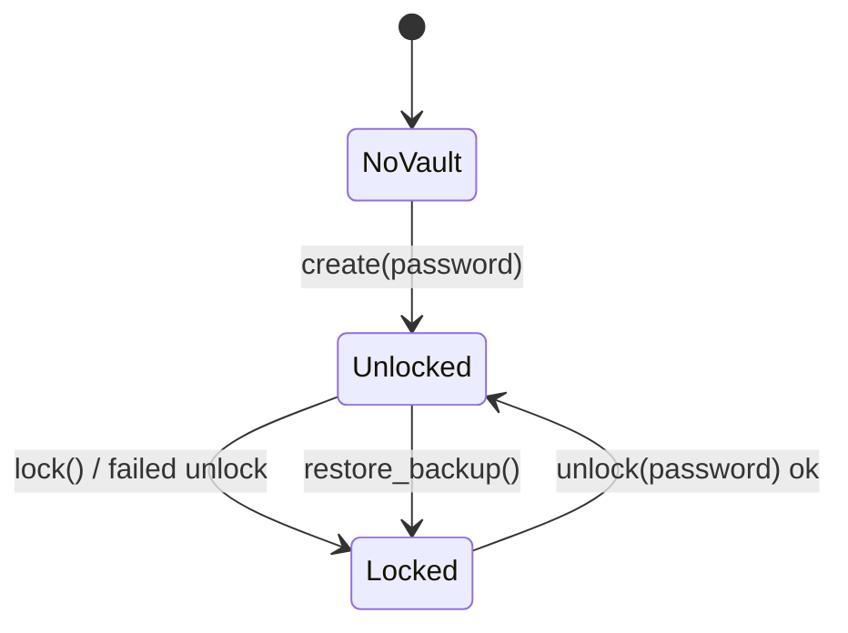

# src-tauri/src/vault/session.rs

## Purpose

Owns the vault folder and its locked and unlocked states: creating a vault,
unlocking it, locking it and changing the master password.

## Place in the architecture

- A `Vault` is the single owner of the vault folder. While locked it holds no
  key and no open database.
- Unlocking derives the key from the master password and keeps it, together
  with the database connection, in an `UnlockedVault`. Locking drops both, and
  the key is wiped from memory on drop.
- The session never locks itself. [`state.rs`](../state.rs.md) calls
  `Vault::lock` for the lock command, the inactivity timer and the system
  session lock.
- Operations on an unlocked vault are methods of `UnlockedVault` defined in
  [`entries.rs`](entries.rs.md), [`files.rs`](files.rs.md) and
  [`backup.rs`](backup.rs.md).
- A `Vault` is not thread-safe by itself. The application state serializes
  access to it.



## Public API

| Item                                                  | Description                                                              |
| ----------------------------------------------------- | ------------------------------------------------------------------------ |
| `DATABASE_FILE = "vault.db"`                          | Database file name inside the vault folder.                              |
| `FILES_DIR = "files"`                                 | Folder of encrypted files inside the vault folder.                       |
| `struct VaultStatus { exists, unlocked }`             | `Serialize` with camelCase keys. Sent to the interface.                  |
| `struct UnlockedVault`                                | Folder, open connection and key. No `Debug` or `Clone`, on purpose.      |
| `Vault::new(dir)`                                     | A vault that uses `KdfParams::DEFAULT` for new keys.                     |
| `Vault::with_kdf(dir, kdf)`                           | Same with explicit parameters (tests use small ones).                    |
| `dir()`, `database_path()`                            | Vault folder and database path.                                          |
| `exists()`, `is_unlocked()`, `status()`               | State queries. `exists` is true when `vault.db` is a regular file.       |
| `create(&mut self, password: &str) -> AppResult<()>`  | Creates the vault and leaves it unlocked.                                |
| `unlock(&mut self, password: &str) -> AppResult<()>`  | Unlocks. Locks first, so a failed attempt leaves it locked.              |
| `lock(&mut self)`                                     | Drops the session. Locking a locked vault does nothing.                  |
| `change_master_password(&mut self, current: &str, new: &str) -> AppResult<()>` | Replaces the key header.                     |
| `unlocked(&self) -> AppResult<&UnlockedVault>`        | The session, or `Locked`.                                                |
| `unlocked_mut(&mut self) -> AppResult<&mut UnlockedVault>` | Mutable session, or `Locked`.                                       |

Crate-visible: `UnlockedVault` fields `dir`, `conn`, `key`; `files_dir()`;
`read_header(conn)`.

Errors:

- `create`: `InvalidInput` if the password breaks the
  [policy](password_policy.rs.md); `VaultExists` if the folder already holds a
  vault; file system, storage or cryptographic errors.
- `unlock`: `VaultNotFound` if there is no vault; `WrongPasswordOrCorrupt` for a
  wrong password; `Corrupt` or `UnsupportedVersion` if the vault cannot be read.
- `change_master_password`: `Locked`; `WrongPasswordOrCorrupt` if `current` is
  wrong or the header does not unwrap to the key in use; `InvalidInput` if
  `new` breaks the policy or equals `current`.

Side effects: `create` makes the folder, `files/` and `vault.db`. `unlock`,
`create` and `lock` open and close the database. `change_master_password`
rewrites one row.

## Internal structure

- `create` validates the password, refuses an existing vault, makes
  `files/`, then writes the database under the name `vault.db.creating`
  (removing a stale one first) with the header in `meta`, and renames it to
  `vault.db`. An interrupted creation never leaves a half-made vault. It then
  opens the final database and keeps the new key.
- `unlock` calls `lock`, opens the database, reads the header with
  `read_header` and unwraps the vault key.
- `change_master_password` reads the header, unwraps it with `current` and
  requires the result to equal the key in use. It then checks the new password
  and wraps the same key with a fresh salt under this vault's Argon2id
  parameters. The header replacement runs in one transaction.

## Dependencies

- Internal: [`header.rs`](header.rs.md), [`password_policy.rs`](password_policy.rs.md),
  [`storage/db.rs`](../storage/db.rs.md), [`crypto/kdf.rs`](../crypto/kdf.rs.md),
  [`crypto/keys.rs`](../crypto/keys.rs.md), [`error.rs`](../error.rs.md).
- External: `rusqlite` (the connection type), `serde` (serializing
  `VaultStatus`).

## Usage example

Checked by running it against the library:

```rust
use lockwell_lib::vault::Vault;

let mut vault = Vault::with_kdf(dir.join("vault"), kdf_params);
vault.create("correct horse battery")?;     // status: exists, unlocked
vault.change_master_password("correct horse battery", "another long password")?;
vault.lock();
// vault.unlocked() == Err(Locked)
// vault.unlock("correct horse battery") == Err(WrongPasswordOrCorrupt)
vault.unlock("another long password")?;
```

Observed: changing to the same password returns
`InvalidInput("the new master password must be different from the current one")`.

## Edge cases, invariants and error handling

- A failed `unlock` locks a vault that was unlocked. A successful `unlock` of
  an unlocked vault keeps it unlocked.
- `create` on a folder that has a stale `vault.db.creating` replaces it.
- `exists` only checks that `vault.db` is a file. A damaged file still counts
  as existing and fails later in `unlock`.
- The key header is checked again on a password change even though the vault is
  unlocked, and must unwrap to the key in use.
- The new header uses the Argon2id parameters of this `Vault`, not those of the
  old header. After a change the parameters of a vault created with other
  settings become the current ones.

## Security

- Locking drops the connection and the key, which is wiped on drop.
- `UnlockedVault` has no `Debug` and no `Clone`, so the key cannot be printed or
  duplicated through it.
- The master password arrives as `&str`. Wiping it is the caller's job.
- The password policy applies on create and change, not on unlock.
- Key derivation is slow. Callers should run `create`, `unlock` and
  `change_master_password` in a blocking context.

## Related files and tests

- Related: [`header.rs`](header.rs.md), [`password_policy.rs`](password_policy.rs.md),
  [`entries.rs`](entries.rs.md), [`files.rs`](files.rs.md),
  [`backup.rs`](backup.rs.md), [`state.rs`](../state.rs.md),
  [`commands/vault.rs`](../commands/vault.rs.md).
- Tests: inline `tests` module in
  [`session.rs`](../../../../../src-tauri/src/vault/session.rs). It exports
  `PASSWORD` and `unlocked_vault()` for the other vault tests. Integration
  tests are in
  [`vault_lifecycle.rs`](../../../../../src-tauri/tests/vault_lifecycle.rs).
