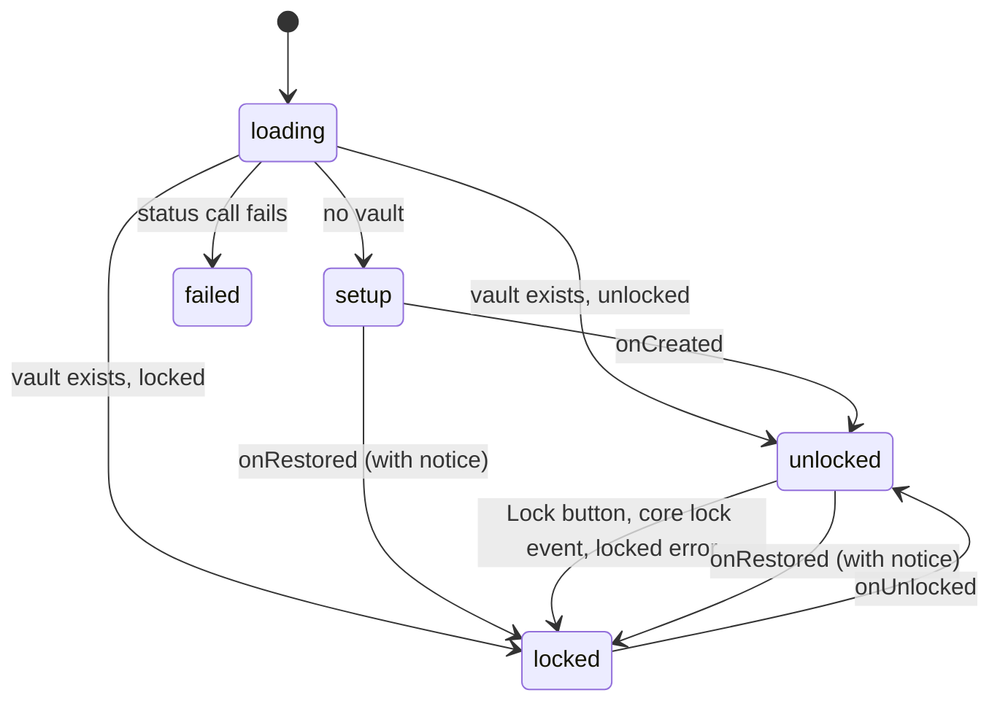

# src/App.tsx

## Purpose

Root component and top-level state machine of the interface: loading, setup (no vault
yet), locked and unlocked. It chooses which screen to show.

## Place in the architecture

- The core is the source of truth for the vault status. `App` asks it once on start with
  [`getVaultStatus`](api/vault.ts.md) and then follows the events of the screens.
- [`main.tsx`](main.tsx.md) mounts it. It renders one of
  [`SetupScreen`](screens/SetupScreen.tsx.md), [`UnlockScreen`](screens/UnlockScreen.tsx.md)
  or [`VaultScreen`](screens/VaultScreen.tsx.md), or a loading or error message.
- It is also where the notice shown on the unlock screen is chosen, from the reason the
  core gives for an automatic lock.

## Public API

Default export `App()`. It takes no props.

Internal pieces (not exported):

| Item              | Description                                                                                                  |
| ----------------- | ------------------------------------------------------------------------------------------------------------ |
| `Phase`           | `loading`, `failed` (with a message), `setup`, `locked` (with an optional notice) or `unlocked`.            |
| `LOCK_NOTICES`    | `idle`: `The vault was locked after 5 minutes of inactivity.` `systemLock`: `The vault was locked because Windows was locked.` |
| `RESTORED_NOTICE` | `Backup restored. Unlock it with the master password it had when the backup was made.`                       |
| `phaseFor(status)` | No vault gives `setup`. A vault that is unlocked gives `unlocked`, otherwise `locked`.                       |

## Internal structure



- A `useEffect` on mount calls `getVaultStatus` and sets the phase from the result, or to
  `failed` with `errorMessage(error)`.
- `showLocked(reason?)`, `showRestored()` and `lock()` are memoized with `useCallback`, so
  the hooks that take them as arguments do not re-register on every render.
- `lock()` calls `lockVault()` and goes to `locked` in a `finally`, whether the call
  succeeded or not: the interface must never keep showing decrypted data after the user
  asked to lock.
- The `switch` over `phase.kind` renders each screen. `setup` passes `onCreated` (go to
  `unlocked`) and `onRestored`. `locked` passes the notice and `onUnlocked`. `unlocked`
  passes `onLock`, `onLocked` and `onRestored`.

## Dependencies

- Internal: [`api/client.ts`](api/client.ts.md), [`api/security.ts`](api/security.ts.md)
  (`LockReason`), [`api/types.ts`](api/types.ts.md), [`api/vault.ts`](api/vault.ts.md),
  [`screens/SetupScreen.tsx`](screens/SetupScreen.tsx.md),
  [`screens/UnlockScreen.tsx`](screens/UnlockScreen.tsx.md),
  [`screens/VaultScreen.tsx`](screens/VaultScreen.tsx.md).
- External: `react` (`useCallback`, `useEffect`, `useState`).

## Usage example

[`main.tsx`](main.tsx.md) renders it:

```tsx
<React.StrictMode>
  <App />
</React.StrictMode>
```

The behaviour was checked by the tests of `App` (`vitest run`): a first run shows the setup
screen, a locked vault the unlock screen, and an unlocked one the vault.

## Edge cases, invariants and error handling

- If the vault is already unlocked when the app starts (for example after the page is
  reloaded while the core keeps running), it goes straight to the vault screen.
- A failed status call shows `The vault could not be opened: <message>` with
  `role="alert"`.
- **Observation, not fixed (from reading the code):** the `failed` screen has no retry
  button, and nothing calls `getVaultStatus` again. The user has to restart the app.
- **Observation, not fixed:** the idle notice says `5 minutes` as fixed text. It mirrors
  `IDLE_TIMEOUT` in [`security/autolock.rs`](../src-tauri/src/security/autolock.rs.md), and
  nothing checks that the two agree.
- Under `React.StrictMode` in development the start effect runs twice, so the status is
  requested twice. The result is the same.
- If locking fails on the way (the call rejects), the user still sees the unlock screen.
  Unlocking calls lock first in the core, so the state cannot stay half-open.

## Security

- The interface keeps no secret at this level. Everything decrypted lives in the
  `VaultScreen` tree, which unmounts when the phase leaves `unlocked`.
- Every way of locking (button, core event, `locked` error, restore) goes through the
  same phase change, so the screen with decrypted data is always removed.
- The notice tells the user why an automatic lock happened, so it is never silent.

## Related files and tests

- Related: [`main.tsx`](main.tsx.md), [`screens/SetupScreen.tsx`](screens/SetupScreen.tsx.md),
  [`screens/UnlockScreen.tsx`](screens/UnlockScreen.tsx.md),
  [`screens/VaultScreen.tsx`](screens/VaultScreen.tsx.md),
  [`api/vault.ts`](api/vault.ts.md).
- Tests: [`App.test.tsx`](../../../src/App.test.tsx) covers each phase, a status failure,
  locking (also when the call fails), the lock event with its reason (idle and Windows),
  restoring a backup, activity reports and a `locked` error from a tab. The full flows are
  in [`flows.test.tsx`](../../../src/e2e/flows.test.tsx).
