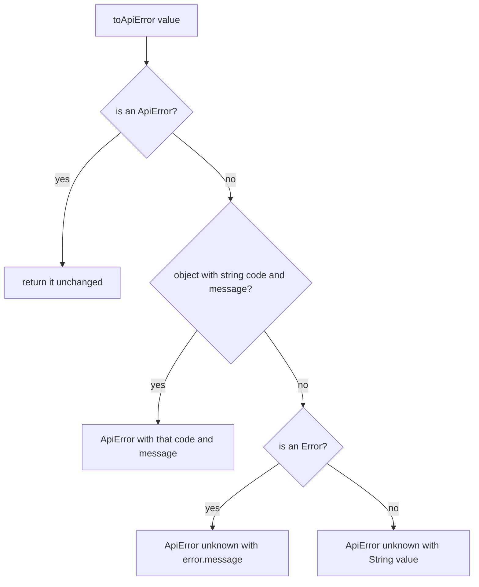

# src/api/client.ts

## Purpose

Typed access to the Tauri commands and their errors. Every command wrapper in
this folder goes through `call`, so errors from the Rust core reach the
components as `ApiError` instances.

## Place in the architecture

- The interface never calls `invoke` directly. [`vault.ts`](vault.ts.md),
  [`entries.ts`](entries.ts.md), [`files.ts`](files.ts.md),
  [`backup.ts`](backup.ts.md) and [`security.ts`](security.ts.md) all use `call`.
- The core serializes a failed command as `{ "code", "message" }`
  ([`error.rs`](../../src-tauri/src/error.rs.md)). This file turns that into an
  `ApiError` and provides predicates and a message formatter for the screens.
- Components that show errors use it through
  [`useApiError`](../hooks/useApiError.ts.md) and directly in the forms and
  screens that check for a wrong password or a locked vault.

## Public API

| Item                                                      | Description                                                                               |
| --------------------------------------------------------- | ----------------------------------------------------------------------------------------- |
| `class ApiError extends Error`                            | Has a read-only `code: ErrorCode`. `name` is `"ApiError"`. Constructor `(code, message)`. |
| `call<T>(command: string, args?: InvokeArgs): Promise<T>` | Calls a command. Rejects with `ApiError`.                                                 |
| `toApiError(error: unknown): ApiError`                    | Normalizes anything thrown by `invoke`.                                                   |
| `isLockedError(error: unknown): boolean`                  | `true` for an `ApiError` with code `locked`.                                              |
| `isWrongPasswordError(error: unknown): boolean`           | `true` for an `ApiError` with code `wrong_password`.                                      |
| `errorMessage(error: unknown): string`                    | A message for people: capitalized, ending with a period.                                  |

Parameters of `call`: `command` is the Rust command name in snake_case, `args`
has camelCase keys. Errors: rejects with `ApiError`. Side effects: one IPC call.

## Internal structure



`errorMessage` trims the message, falls back to `Something went wrong` when it is
empty, uppercases the first character and adds a period unless the text already
ends in `.`, `!` or `?`. The private `isErrorPayload` checks the
`{ code, message }` shape.

## Dependencies

- Internal: [`types.ts`](types.ts.md) (`ErrorCode`).
- External: `@tauri-apps/api/core` (`invoke`, `InvokeArgs`), the bridge to the
  Rust core.

## Usage example

Checked by running the real module with Node:

```ts
import { ApiError, toApiError, errorMessage } from "./client";

const error = toApiError({ code: "locked", message: "the vault is locked" });
error instanceof ApiError;                 // true, error.code === "locked"
toApiError(new Error("boom")).code;        // "unknown"
toApiError({ code: 1, message: "x" }).code; // "unknown" (the code is not a string)
errorMessage({ code: "io", message: "disk full" }); // "Disk full."
errorMessage({ code: "io", message: "Done!" });     // "Done!"
errorMessage({ code: "io", message: "  " });        // "Something went wrong."
```

Outside Tauri, `call("vault_status")` rejects with an `ApiError` of code
`unknown` and the message `window is not defined`.

## Edge cases, invariants and error handling

- An `ApiError` passes through unchanged, so conversions can be repeated safely.
- Values that are not errors become `unknown` with their text (`null` gives
  `"null"`).
- **Observation, not fixed:** the `code` of a payload is cast to `ErrorCode`
  without checking it. A code the core adds but this file does not know, for
  example `made_up`, is passed on as is. The type then claims more than it
  knows.
- **Observation, not fixed:** `errorMessage` of a non-error value reads oddly:
  `errorMessage(undefined)` gives `"Undefined."`.
- A thrown value with an empty message gives the generic fallback.

## Security

- Error messages come from the core and never contain secrets. This file does not
  add any text of its own that could include one.
- The module holds no state and logs nothing.

## Related files and tests

- Related: [`types.ts`](types.ts.md), [`vault.ts`](vault.ts.md),
  [`../hooks/useApiError.ts`](../hooks/useApiError.ts.md),
  [`../../src-tauri/src/error.rs`](../../src-tauri/src/error.rs.md).
- Tests: [`client.test.ts`](../../../../src/api/client.test.ts) covers the error
  conversion, the predicates, the message formatter and `call`. The mock of
  `invoke` is in `src/test/tauriMock.ts`.
