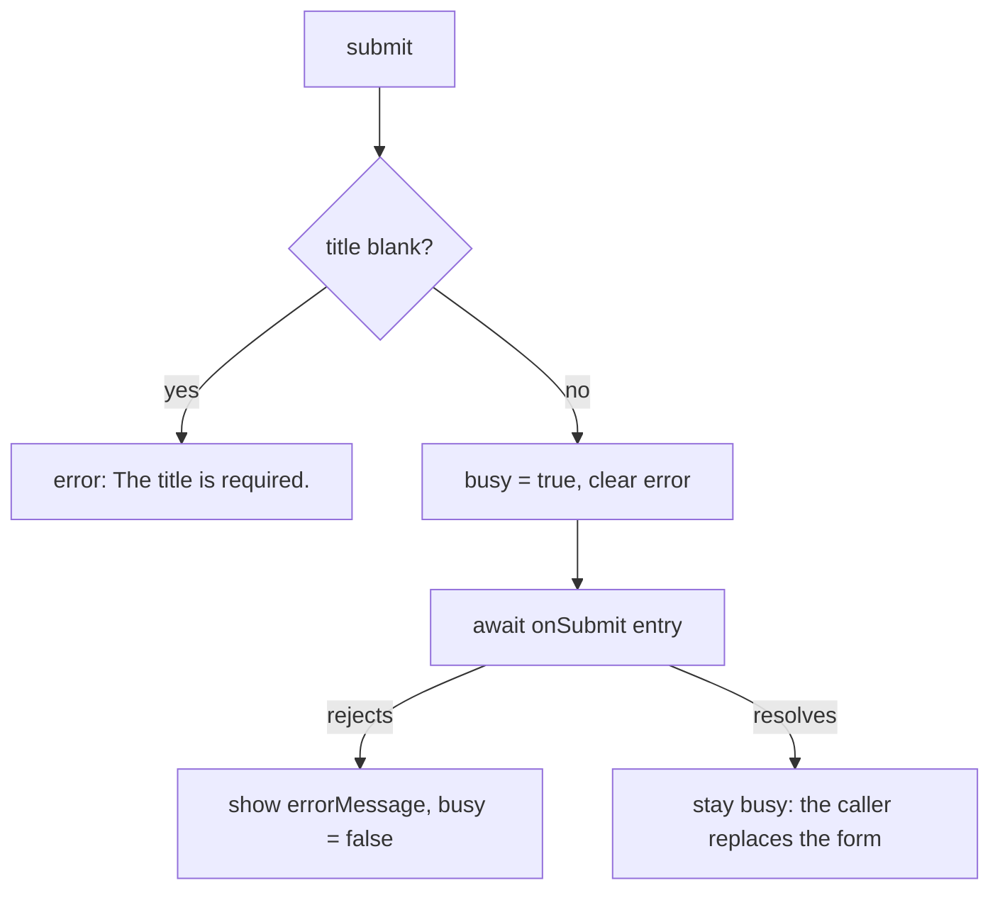

# src/components/EntryForm.tsx

## Purpose

Form to create or edit a password entry.

## Place in the architecture

Used by [`PasswordsTab`](../screens/PasswordsTab.tsx.md) for both flows: a new
entry, and editing the one shown in [`EntryView`](EntryView.tsx.md). It only checks
that the title is present. The core validates everything again
([`vault/entries.rs`](../../src-tauri/src/vault/entries.rs.md)). The caller supplies
`onSubmit`, which saves through [`entries.ts`](../api/entries.ts.md).

## Public API

Default export `EntryForm(props)`:

| Prop          | Type                                  | Description                                                                 |
| ------------- | ------------------------------------- | --------------------------------------------------------------------------- |
| `heading`     | `string`                              | Title of the form, such as `New entry`.                                     |
| `initial`     | `EntryInput`                          | Optional. Values to start from. An empty entry by default.                  |
| `submitLabel` | `string`                              | Text of the submit button.                                                  |
| `onSubmit`    | `(entry: EntryInput) => Promise<void>` | Saves the entry. A rejected promise shows its error in the form.            |
| `onCancel`    | `() => void`                          | Called by the Cancel button. Nothing is saved.                              |

Fields: Title, Username, Password (a [`PasswordInput`](PasswordInput.tsx.md)),
Website and Notes.

## Internal structure



- The state starts from a copy of only the five editable fields of `initial`. The
  initial value may be a full `Entry`, and the core rejects unknown fields such as
  `id` or `createdAt`, so extra properties are never sent.
- `update(field, value)` changes one field with a functional state update.
- Each input has a `maxLength` taken from `ENTRY_LIMITS`
  ([`entryRules.ts`](../entryRules.ts.md)). The form uses `noValidate`, so errors
  come from the component and not from the browser.
- The form stays busy after a successful submit, because the caller then replaces it
  with another view.

## Dependencies

- Internal: [`api/client.ts`](../api/client.ts.md) (`errorMessage`),
  [`api/types.ts`](../api/types.ts.md) (`EntryInput`),
  [`entryRules.ts`](../entryRules.ts.md) (`ENTRY_LIMITS`),
  [`ErrorBanner.tsx`](ErrorBanner.tsx.md), [`PasswordInput.tsx`](PasswordInput.tsx.md).
- External: `react` (`useState`, `FormEvent`).

## Usage example

As in [`PasswordsTab`](../screens/PasswordsTab.tsx.md). Checked by the component
tests:

```tsx
<EntryForm
  heading="New entry"
  submitLabel="Add entry"
  onSubmit={create}   // creates the entry, reloads the list and opens it
  onCancel={() => setMode({ kind: "empty" })}
/>

// Editing passes the full entry as `initial` and a key, so the form restarts
// when another entry is edited:
<EntryForm
  key={mode.entry.id}
  heading="Edit entry"
  initial={mode.entry}
  submitLabel="Save changes"
  onSubmit={(input) => update(mode.entry.id, input)}
  onCancel={() => setMode({ kind: "view", entry: mode.entry })}
/>
```

## Edge cases, invariants and error handling

- A title that is empty or only spaces gives `The title is required.` and nothing is
  sent.
- A rejected `onSubmit` shows its message with `errorMessage`, re-enables the buttons
  and keeps what the user typed.
- While saving, both buttons are disabled and the submit button reads `Saving…`.
- The initial state is read once. Changing `initial` later does not reset the form,
  so the parent must give the form a new `key` to start from different values.
- **Observation, not fixed (from the HTML specification, not run):** `maxLength` on
  an input counts UTF-16 code units, while the core counts Unicode characters. A
  character outside the Basic Multilingual Plane, such as an emoji, counts as 2 in
  the browser and as 1 in the core, so the form can stop the user slightly before
  the limit the core accepts. It never allows more than the core.

## Security

- The password is held in component state as a plain string until the form is
  closed. JavaScript cannot wipe it.
- The form sends only the five fields, so no identifier or timestamp can be forged
  through it.
- `autoComplete="off"` keeps the browser from offering to save the entry's fields as
  credentials.

## Related files and tests

- Related: [`PasswordInput.tsx`](PasswordInput.tsx.md),
  [`ErrorBanner.tsx`](ErrorBanner.tsx.md), [`EntryView.tsx`](EntryView.tsx.md),
  [`../entryRules.ts`](../entryRules.ts.md),
  [`../screens/PasswordsTab.tsx`](../screens/PasswordsTab.tsx.md).
- Tests: [`entries.test.tsx`](../../../../src/components/entries.test.tsx) covers
  sending only the editable fields, typing in every field, starting empty, the
  field limits, the required title, save errors, the busy state and cancelling.
