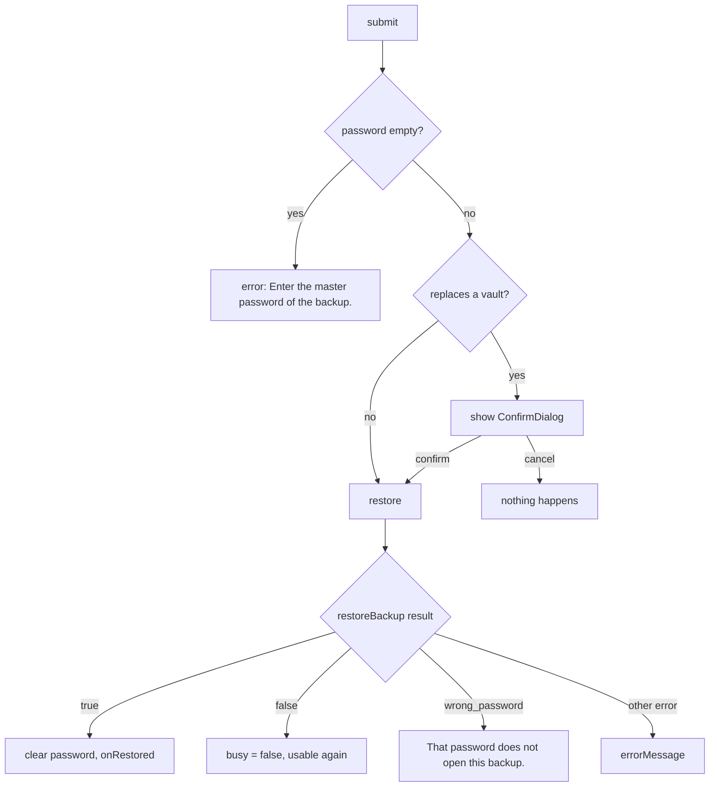

# src/components/RestoreBackupForm.tsx

## Purpose

Form that restores an encrypted backup, either on first run or from the settings.

## Place in the architecture

Used by [`SetupScreen`](../screens/SetupScreen.tsx.md) (no vault yet) and
[`SettingsTab`](../screens/SettingsTab.tsx.md) (the restore replaces the current
vault). It asks for the master password the vault had when the backup was made, then
[`restoreBackup`](../api/backup.ts.md) makes the core show the file dialog and do the
restore ([`vault/backup.rs`](../../src-tauri/src/vault/backup.rs.md)). After a
successful restore the vault is locked, so `onRestored` takes the user back to the
unlock step.

## Public API

Default export `RestoreBackupForm({ replacesVault, onRestored })`:

| Prop            | Type         | Description                                                              |
| --------------- | ------------ | ------------------------------------------------------------------------ |
| `replacesVault` | `boolean`    | Whether a vault exists and will be replaced. It asks for confirmation.   |
| `onRestored`    | `() => void` | Called after a successful restore. The vault is then locked.             |

## Internal structure



State: `password`, `error`, `busy` and `confirming`. After a success the form
clears the password and stays busy, because the caller replaces it. After a
cancelled file dialog or an error, `busy` goes back to `false`.

## Dependencies

- Internal: [`api/backup.ts`](../api/backup.ts.md), [`api/client.ts`](../api/client.ts.md)
  (`errorMessage`, `isWrongPasswordError`), [`ConfirmDialog.tsx`](ConfirmDialog.tsx.md),
  [`ErrorBanner.tsx`](ErrorBanner.tsx.md), [`PasswordInput.tsx`](PasswordInput.tsx.md).
- External: `react` (`useState`, `FormEvent`).

## Usage example

As in [`SetupScreen`](../screens/SetupScreen.tsx.md) and
[`SettingsTab`](../screens/SettingsTab.tsx.md). Checked by the component tests:

```tsx
<RestoreBackupForm replacesVault={false} onRestored={onRestored} /> // first run
<RestoreBackupForm replacesVault onRestored={onRestored} />         // settings
```

## Edge cases, invariants and error handling

- The form only checks that the password is not empty. The core checks the length and
  the content of the backup.
- When it replaces a vault, a confirmation dialog warns that all current passwords
  and files will be replaced and that it cannot be undone. Cancelling it changes
  nothing.
- A wrong password gives a specific message. Any other error uses `errorMessage`.
- A cancelled file dialog is not an error. The form becomes usable again.
- After an error the password stays in the field, so the user can correct it.
- A failed restore leaves the current vault untouched (the core guarantees it).

## Security

- The password is held in state until the restore succeeds, when it is cleared. On
  failure it stays so the user can retry. JavaScript cannot wipe it from memory.
- The backup is only as private as the master password it was made under, and a
  restore needs that password, not the current one.
- The replacement confirmation protects against destroying the current vault by
  mistake.

## Related files and tests

- Related: [`CreateBackupPanel.tsx`](CreateBackupPanel.tsx.md),
  [`ConfirmDialog.tsx`](ConfirmDialog.tsx.md),
  [`../api/backup.ts`](../api/backup.ts.md),
  [`../screens/SetupScreen.tsx`](../screens/SetupScreen.tsx.md),
  [`../screens/SettingsTab.tsx`](../screens/SettingsTab.tsx.md),
  [`../../src-tauri/src/commands/backup.rs`](../../src-tauri/src/commands/backup.rs.md).
- Tests: [`backup.test.tsx`](../../../../src/components/backup.test.tsx) covers
  restoring without confirmation, asking before replacing, cancelling the
  replacement, the required password, the wrong password message, other errors and
  staying usable after a cancel.
