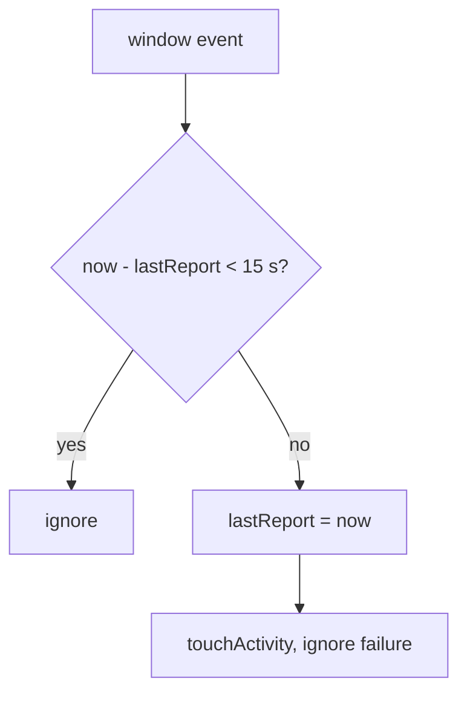

# src/hooks/useActivityReporter.ts

## Purpose

React hook that tells the core when the user is active, so the automatic lock only
happens after real inactivity.

## Place in the architecture

- The core locks the vault after 5 minutes without activity
  ([`security/autolock.rs`](../../src-tauri/src/security/autolock.rs.md)). Every
  command already counts as activity there. This hook covers the time the user
  spends typing or moving the mouse without calling a command.
- [`VaultScreen`](../screens/VaultScreen.tsx.md) calls it while the vault is
  unlocked, so reports stop when the screen unmounts.
- It sends the report through [`touchActivity`](../api/security.ts.md), which calls
  the `touch_activity` command.

## Public API

| Item                                      | Description                                                              |
| ----------------------------------------- | ------------------------------------------------------------------------ |
| `ACTIVITY_REPORT_INTERVAL_MS = 15_000`    | Minimum time between two reports, in milliseconds.                       |
| `useActivityReporter(): void`             | Takes no arguments and returns nothing.                                  |

Side effects: while the component is mounted, it registers passive listeners on
`window` for `keydown`, `mousedown`, `mousemove`, `wheel` and `touchstart`, and
calls `touch_activity` at most once per interval. It never throws. A failed report
is ignored.

## Internal structure



A single `useEffect` with no dependencies keeps a local `lastReport` (initially 0,
so the first event reports at once) and the `report` function. The cleanup removes
the same listeners.

## Dependencies

- Internal: [`api/security.ts`](../api/security.ts.md) (`touchActivity`).
- External: `react` (`useEffect`).

## Usage example

As used in [`VaultScreen`](../screens/VaultScreen.tsx.md). The behaviour was
checked by the hook tests (`vitest run src/hooks`):

```tsx
function VaultScreen() {
  useActivityReporter(); // reports keyboard, mouse, wheel and touch activity
  // ...
}
```

## Edge cases, invariants and error handling

- The first event after mounting is reported immediately. Later events inside the
  15-second window are dropped.
- A lost report can only make the lock happen sooner, never later, so failures are
  safe to ignore. The next event after the interval tries again.
- Unmounting removes all five listeners.
- **Observation, not fixed (from reading the code, not run):** the interval is
  measured with `Date.now()`, which follows the system clock. If the clock is set
  back, `now - lastReport` becomes negative and stays under 15 seconds until the
  clock passes the old `lastReport`, so reports are suppressed for as long as the
  clock was moved back. The core would then count only commands as activity and
  could lock while the user is typing in a form. A monotonic clock such as
  `performance.now()` would avoid it.

## Security

- This hook only postpones the lock when the user really interacts. It must be
  mounted only while the vault is unlocked, so an idle login screen does not
  generate reports.
- It sends no data, only a signal.

## Related files and tests

- Related: [`../api/security.ts`](../api/security.ts.md),
  [`../screens/VaultScreen.tsx`](../screens/VaultScreen.tsx.md),
  [`useVaultLockedEvent.ts`](useVaultLockedEvent.ts.md),
  [`../../src-tauri/src/security/autolock.rs`](../../src-tauri/src/security/autolock.rs.md).
- Tests: [`hooks.test.tsx`](../../../../src/hooks/hooks.test.tsx) covers each of
  the five events, the throttling, reporting again after the interval, removing the
  listeners and continuing after a failed report.
