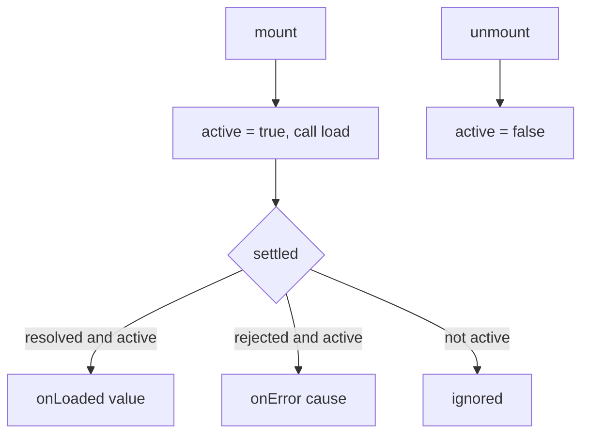

# src/hooks/useInitialLoad.ts

## Purpose

React hook that loads data once when a component mounts and hands the result, or
the failure, to callbacks. Results that arrive after the component has unmounted
are ignored.

## Place in the architecture

[`PasswordsTab`](../screens/PasswordsTab.tsx.md) uses it to load the entry list
and [`FilesTab`](../screens/FilesTab.tsx.md) to load the file list. Both pass the
command wrapper from [`api/`](../api/entries.ts.md), a state setter and the
`report` function of [`useApiError`](useApiError.ts.md).

## Public API

`useInitialLoad<T>(load: () => Promise<T>, onLoaded: (value: T) => void, onError: (cause: unknown) => void): void`

| Parameter  | Description                                          |
| ---------- | ---------------------------------------------------- |
| `load`     | Starts the load. Called once per mount.              |
| `onLoaded` | Receives the resolved value.                         |
| `onError`  | Receives the rejection reason.                       |

`load`, `onLoaded` and `onError` must be stable between renders, as the load runs
again whenever one of them changes. The hook returns nothing and throws nothing.

## Internal structure



A single `useEffect` depending on the three arguments. A closure variable `active`
turns to `false` in the cleanup, which discards late results and prevents state
updates on an unmounted component.

## Dependencies

- Internal: none.
- External: `react` (`useEffect`).

## Usage example

As in [`PasswordsTab`](../screens/PasswordsTab.tsx.md). Behaviour checked by the
hook tests:

```tsx
const { error, report } = useApiError(onLocked);
useInitialLoad(listEntries, setEntries, report);
// listEntries is a module function and setEntries a state setter: both are stable,
// report is stable as long as onLocked is.
```

## Edge cases, invariants and error handling

- A result that arrives after unmounting is dropped, whether it is a value or a
  failure.
- If any argument changes identity, the effect restarts: the previous load is
  discarded and `load` runs again. Inline arrow functions would therefore reload on
  every render.
- A load that never settles leaves the callbacks uncalled and costs nothing.
- Only the latest effect run is active. An earlier run that settles later is
  ignored.

## Security

The hook handles no secrets itself. What `load` returns is passed on to the
caller, so the caller decides how long that data is kept.

## Related files and tests

- Related: [`useApiError.ts`](useApiError.ts.md),
  [`../screens/PasswordsTab.tsx`](../screens/PasswordsTab.tsx.md),
  [`../screens/FilesTab.tsx`](../screens/FilesTab.tsx.md).
- Tests: [`hooks.test.tsx`](../../../../src/hooks/hooks.test.tsx) covers passing the
  result, passing a failure and ignoring a result after unmounting.
