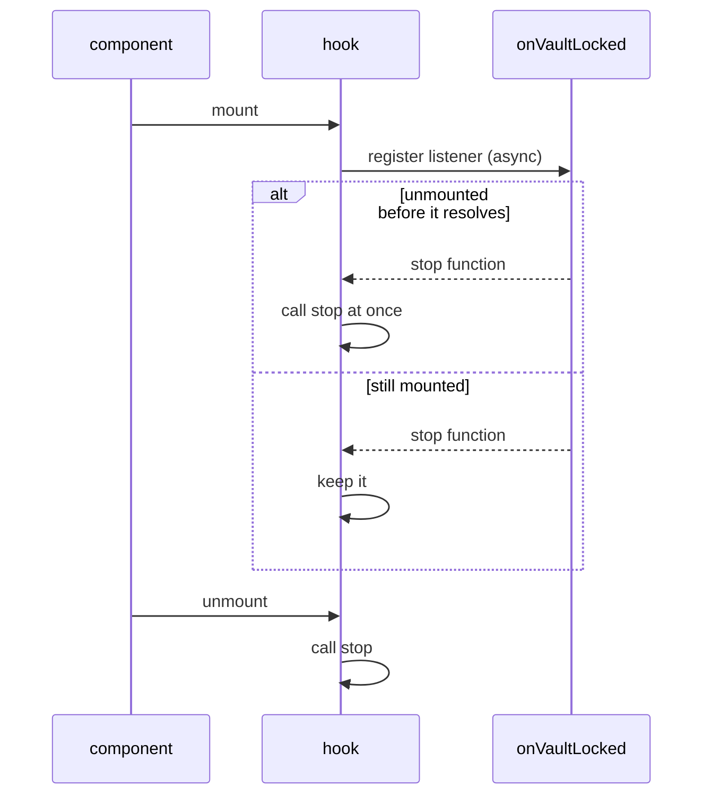

# src/hooks/useVaultLockedEvent.ts

## Purpose

React hook that calls a callback when the core locks the vault without a user
request (inactivity or Windows lock), so the interface drops its decrypted state at
once.

## Place in the architecture

- The core emits the `vault-locked` event with the reason
  ([`security/mod.rs`](../../src-tauri/src/security/mod.rs.md)).
  [`api/security.ts`](../api/security.ts.md) wraps the subscription as
  `onVaultLocked`, and this hook ties it to the lifetime of a component.
- [`VaultScreen`](../screens/VaultScreen.tsx.md) uses it and passes a callback that
  leads back to the unlock screen.
- A lock requested by the user does not emit the event. That case is handled by the
  screen directly.

## Public API

`useVaultLockedEvent(onLocked: (reason: LockReason) => void): void`

- `reason` is `"idle"` or `"systemLock"`.
- `onLocked` should be stable between renders: the listener is registered again
  whenever it changes.
- Returns nothing and throws nothing. If it cannot listen, it writes a line with
  `console.error` (see below).

## Internal structure



One `useEffect` depending on `onLocked`. A closure flag `active` and the stored
`unlisten` function handle the case where the component unmounts before the
asynchronous registration finishes.

## Dependencies

- Internal: [`api/security.ts`](../api/security.ts.md) (`onVaultLocked`,
  `LockReason`).
- External: `react` (`useEffect`).

## Usage example

As in [`VaultScreen`](../screens/VaultScreen.tsx.md). Behaviour checked by the hook
tests:

```tsx
useVaultLockedEvent((reason) => {
  // reason is "idle" or "systemLock": show the unlock screen
});
```

## Edge cases, invariants and error handling

- If the component unmounts before the listener is ready, the listener is removed as
  soon as it is, so no handler is left behind.
- If registration fails, the hook logs
  `lockwell: cannot listen for vault lock events` with the error. Without the event
  the interface still finds out on its next command, which fails with `locked`.
- A changing `onLocked` makes the hook unsubscribe and subscribe again. Between the
  two there is a short moment without a listener.

## Security

- The event only says that the vault is locked and why. The hook never receives vault
  data.
- A missed event cannot keep the vault open: the lock happens in the core. The risk
  is only that decrypted data stays on screen until the next command, which is why
  the event exists.

## Related files and tests

- Related: [`../api/security.ts`](../api/security.ts.md),
  [`../screens/VaultScreen.tsx`](../screens/VaultScreen.tsx.md),
  [`useActivityReporter.ts`](useActivityReporter.ts.md),
  [`../../src-tauri/src/security/mod.rs`](../../src-tauri/src/security/mod.rs.md).
- Tests: [`hooks.test.tsx`](../../../../src/hooks/hooks.test.tsx) covers passing the
  reason, removing the listener on unmount, removing it at once when unmounted before
  it is ready, and logging when listening fails.
