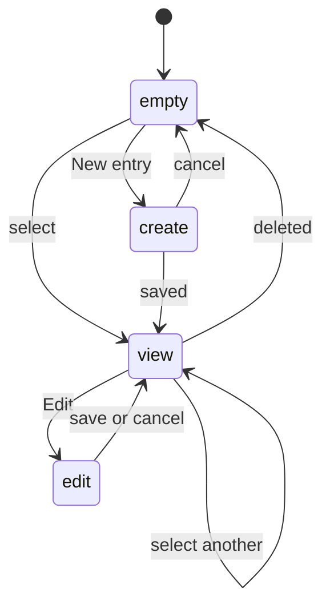

# src/screens/PasswordsTab.tsx

## Purpose

Passwords tab: the entry list with search on the left, and the selected entry (view,
edit or create form) on the right.

## Place in the architecture

One of the three tabs of [`VaultScreen`](VaultScreen.tsx.md). It combines
[`EntryList`](../components/EntryList.tsx.md),
[`EntryView`](../components/EntryView.tsx.md),
[`EntryForm`](../components/EntryForm.tsx.md) and a
[`ConfirmDialog`](../components/ConfirmDialog.tsx.md), and calls the wrappers in
[`api/entries.ts`](../api/entries.ts.md) and
[`copyEntryField`](../api/security.ts.md). The list carries no passwords. The full entry,
with its password, is fetched only when the user opens it.

## Public API

Default export `PasswordsTab({ onLocked })`:

| Prop       | Type         | Description                                              |
| ---------- | ------------ | -------------------------------------------------------- |
| `onLocked` | `() => void` | Called when the core reports that the vault is locked.   |

## Internal structure

The right-hand panel is driven by a `Mode` value:



State: `entries` (`null` while loading), `query`, `mode`, `confirmDelete`, `deleting`
and the error from [`useApiError`](../hooks/useApiError.ts.md).

- `useInitialLoad(listEntries, setEntries, report)` loads the list. `reload` refreshes
  it and reports errors.
- `visible` is `filterEntries(entries, query)`, memoized
  ([`entryRules.ts`](../entryRules.ts.md)). The search covers title, username and
  website. The core already sorts by title.
- `select(id)` clears the error and loads the full entry with `getEntry`.
- `create` and `update` save, reload the list and open the saved entry. They do not
  catch errors, so a rejection reaches the `EntryForm`, which shows it inside the form.
- `copy(id, field)` clears the error, calls `copyEntryField`, and on failure reports
  the error and throws it again, so `EntryView` knows not to show a success message.
- `remove(id)` deletes, returns to the empty panel and reloads. A failure keeps the
  entry and shows the error.
- The edit form and the view get `key={mode.entry.id}`, so each entry has its own state.

## Dependencies

- Internal: [`api/entries.ts`](../api/entries.ts.md), [`api/security.ts`](../api/security.ts.md),
  [`api/types.ts`](../api/types.ts.md), the five components listed above,
  [`entryRules.ts`](../entryRules.ts.md), [`hooks/useApiError.ts`](../hooks/useApiError.ts.md),
  [`hooks/useInitialLoad.ts`](../hooks/useInitialLoad.ts.md).
- External: `react` (`useCallback`, `useMemo`, `useState`).

## Usage example

As in [`VaultScreen`](VaultScreen.tsx.md). Checked by the screen tests:

```tsx
{tab === "passwords" && <PasswordsTab onLocked={onLocked} />}
```

## Edge cases, invariants and error handling

- An empty vault says `No entries yet. Add your first one.`, and a search with no match
  says `No entries match your search.`
- A failed open of an entry shows an error and keeps the previous panel.
- **Observation, not fixed (from reading the code):** if the first load of the list
  fails, the error banner appears but `entries` stays `null`, so the sidebar keeps
  showing `Loading…`. The tests only check that the alert appears. Creating an entry
  reloads the list and replaces the placeholder.
- Deleting needs confirmation. A cancelled or failed deletion keeps the entry.
- **Observation, not fixed (from reading the code):** `create` and `update` send errors
  to the form through `errorMessage`, not through `report`. A `locked` error there
  appears as `The vault is locked.` inside the form instead of triggering `onLocked`.
  In practice the lock event from the core usually moves the app to the unlock screen
  first.
- **Observation, not fixed (from reading the code):** `create` makes the entry first and
  then reloads and calls `getEntry`. If that last call fails, the form shows an error
  although the entry exists, and submitting again would create a second one.

## Security

- The list never holds passwords or notes. The password is requested only on opening an
  entry, and copying it does not bring it to the interface at all.
- The decrypted entry lives in the `mode` state. It is replaced when another entry is
  selected, and it disappears with the tab (see
  [`VaultScreen`](VaultScreen.tsx.md)).
- Titles and usernames are rendered as text, never as HTML.

## Related files and tests

- Related: [`VaultScreen.tsx`](VaultScreen.tsx.md),
  [`../components/EntryList.tsx`](../components/EntryList.tsx.md),
  [`../components/EntryView.tsx`](../components/EntryView.tsx.md),
  [`../components/EntryForm.tsx`](../components/EntryForm.tsx.md),
  [`../entryRules.ts`](../entryRules.ts.md),
  [`../../src-tauri/src/commands/entries.rs`](../../src-tauri/src/commands/entries.rs.md).
- Tests: [`PasswordsTab.test.tsx`](../../../../src/screens/PasswordsTab.test.tsx) covers
  listing without fetching passwords, searching, masked entries, copying and its
  failure, creating, editing, deleting and cancelling, save and load errors, the locked
  vault and the loading state. The whole flow is also in
  [`flows.test.tsx`](../../../../src/e2e/flows.test.tsx).
