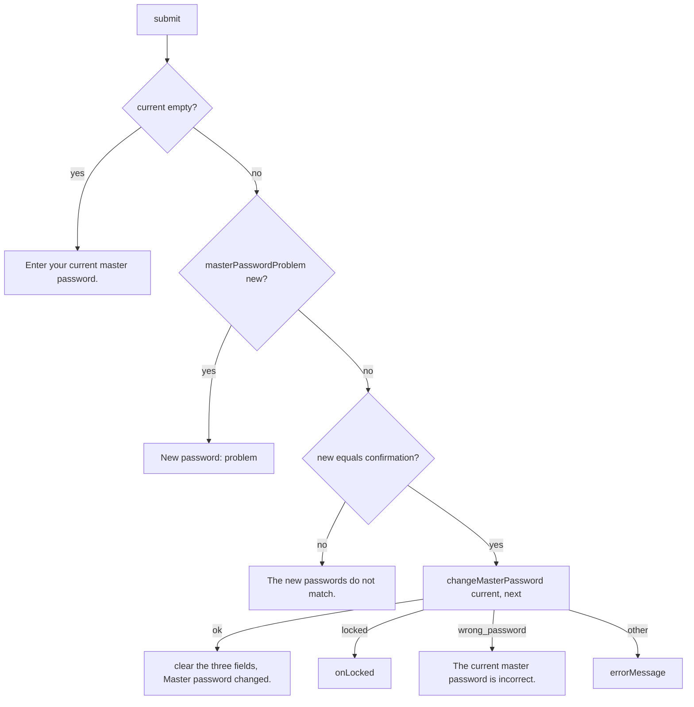

# src/screens/SettingsTab.tsx

## Purpose

Settings tab: change the master password, create an encrypted backup and restore one.

## Place in the architecture

One of the three tabs of [`VaultScreen`](VaultScreen.tsx.md). The password form calls
[`changeMasterPassword`](../api/vault.ts.md). The backup panels are
[`CreateBackupPanel`](../components/CreateBackupPanel.tsx.md) and
[`RestoreBackupForm`](../components/RestoreBackupForm.tsx.md), which call the backup
commands. A `locked` error from any of them hands control back to the app through
`onLocked`.

## Public API

Default export `SettingsTab({ onLocked, onRestored })`:

| Prop         | Type         | Description                                                    |
| ------------ | ------------ | -------------------------------------------------------------- |
| `onLocked`   | `() => void` | Called when the core reports that the vault is locked.         |
| `onRestored` | `() => void` | Called after a backup was restored. The vault is then locked.  |

## Internal structure



- The component keeps `current`, `next`, `confirmation`, `error`, `success` and
  `busy`.
- `backupError(cause)` is the handler passed to the backup panel: a `locked` error
  calls `onLocked` and returns `null` (nothing to show), any other error becomes a
  message.
- Below the form it renders `CreateBackupPanel` and `RestoreBackupForm` with
  `replacesVault`, so a restore from here asks for confirmation.

## Dependencies

- Internal: [`api/client.ts`](../api/client.ts.md), [`api/vault.ts`](../api/vault.ts.md),
  [`components/CreateBackupPanel.tsx`](../components/CreateBackupPanel.tsx.md),
  [`components/ErrorBanner.tsx`](../components/ErrorBanner.tsx.md),
  [`components/PasswordInput.tsx`](../components/PasswordInput.tsx.md),
  [`components/RestoreBackupForm.tsx`](../components/RestoreBackupForm.tsx.md),
  [`passwordRules.ts`](../passwordRules.ts.md).
- External: `react` (`useState`, `FormEvent`).

## Usage example

As in [`VaultScreen`](VaultScreen.tsx.md). Checked by the screen tests:

```tsx
<SettingsTab onLocked={onLocked} onRestored={onRestored} />
```

## Edge cases, invariants and error handling

- The new password must pass the same local rules as on creation, and the core checks
  them again. The core also refuses a new password equal to the current one, which
  shows the core's message.
- After a successful change all three fields are cleared and a success line is shown.
- After a failed change the fields keep their content, so the user can correct a typo.
  This differs from [`UnlockScreen`](UnlockScreen.tsx.md), which clears the field after
  every attempt.
- A `locked` error leaves the screen at once and shows no message.
- The data is not re-encrypted. Only the key header changes, so the change is quick
  apart from the key derivation.
- The backup made afterwards opens with the new password. A backup made before opens
  with the old one.

## Security

- Changing the password needs the current one even though the vault is unlocked, and
  the core checks it again.
- The three password fields are plain strings in state. They are cleared after a
  success and cannot be wiped from memory.
- Error messages never include the typed passwords. A test checks it.

## Related files and tests

- Related: [`VaultScreen.tsx`](VaultScreen.tsx.md),
  [`../components/CreateBackupPanel.tsx`](../components/CreateBackupPanel.tsx.md),
  [`../components/RestoreBackupForm.tsx`](../components/RestoreBackupForm.tsx.md),
  [`../api/vault.ts`](../api/vault.ts.md),
  [`../../src-tauri/src/vault/session.rs`](../../src-tauri/src/vault/session.rs.md).
- Tests: [`SettingsTab.test.tsx`](../../../../src/screens/SettingsTab.test.tsx)
  covers the change, local validation, a wrong current password, a locked vault,
  clearing the fields, the disabled form, other errors and the backup errors.
