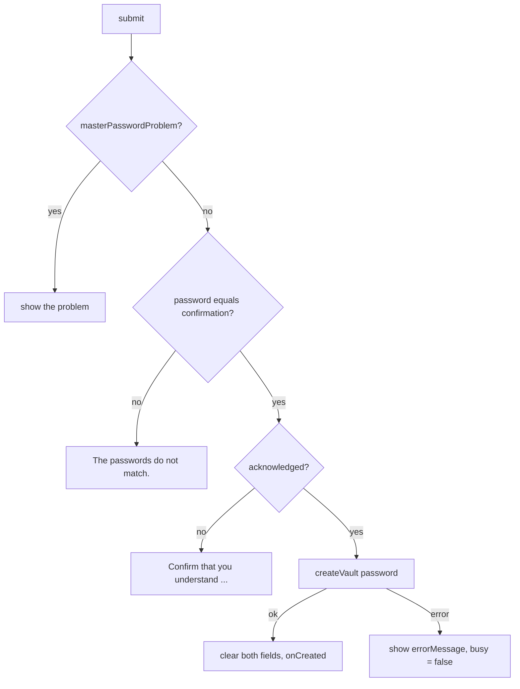

# src/screens/SetupScreen.tsx

## Purpose

First-run screen: the user chooses the master password and creates the vault, or
restores an existing backup instead.

## Place in the architecture

[`App`](../App.tsx.md) shows it when the core reports that no vault exists. It
creates the vault through [`createVault`](../api/vault.ts.md) and reports back with
`onCreated` (the vault is then unlocked) or `onRestored` (a backup was restored and
the vault is locked, so `App` goes to the unlock screen with a notice). The password
is checked here for quick feedback with
[`masterPasswordProblem`](../passwordRules.ts.md) and checked again by the core
([`vault/password_policy.rs`](../../src-tauri/src/vault/password_policy.rs.md)).

## Public API

Default export `SetupScreen({ onCreated, onRestored })`:

| Prop         | Type         | Description                                                      |
| ------------ | ------------ | ---------------------------------------------------------------- |
| `onCreated`  | `() => void` | Called once the vault exists and is unlocked.                    |
| `onRestored` | `() => void` | Called once a backup was restored. The vault is then locked.     |

## Internal structure



State: `restoring` (which of the two views is shown), `password`, `confirmation`,
`acknowledged`, `error` and `busy`. The checks run in the order shown. With
`restoring` set, the screen renders a [`RestoreBackupForm`](../components/RestoreBackupForm.tsx.md)
(with `replacesVault={false}`) and a link back to creating a vault. Otherwise it
renders the form with two [`PasswordInput`](../components/PasswordInput.tsx.md)
fields, a hint, a warning that a forgotten password cannot be recovered, an
acknowledgement checkbox and the submit button.

## Dependencies

- Internal: [`api/client.ts`](../api/client.ts.md), [`api/vault.ts`](../api/vault.ts.md),
  [`components/ErrorBanner.tsx`](../components/ErrorBanner.tsx.md),
  [`components/PasswordInput.tsx`](../components/PasswordInput.tsx.md),
  [`components/RestoreBackupForm.tsx`](../components/RestoreBackupForm.tsx.md),
  [`passwordRules.ts`](../passwordRules.ts.md).
- External: `react` (`useState`, `FormEvent`).

## Usage example

As in [`App`](../App.tsx.md). Checked by the screen tests:

```tsx
<SetupScreen
  onCreated={() => setPhase({ kind: "unlocked" })}
  onRestored={showRestored}
/>
```

## Edge cases, invariants and error handling

- A password under 12 or over 1024 characters, or only spaces, is refused without
  calling the core.
- Creation needs the acknowledgement that the password cannot be recovered. There is
  no recovery in this version.
- If the core rejects the creation, its message is shown, the typed passwords stay,
  and the button is enabled again.
- After success both fields are cleared before `onCreated` runs.
- Switching to the restore view keeps the component mounted, so anything typed in the
  creation form is still in state when the user comes back to it.

## Security

- The passwords are plain strings in component state and cannot be wiped from memory.
  They are cleared from the state after a successful creation.
- Error messages never include the typed password. A test checks it.
- The screen states that nothing leaves the device and that a lost master password
  means the data cannot be decrypted, so the user chooses knowingly.
- The password policy is enforced by the core. The local check is only convenience.

## Related files and tests

- Related: [`../App.tsx`](../App.tsx.md), [`UnlockScreen.tsx`](UnlockScreen.tsx.md),
  [`../components/RestoreBackupForm.tsx`](../components/RestoreBackupForm.tsx.md),
  [`../passwordRules.ts`](../passwordRules.ts.md), [`../api/vault.ts`](../api/vault.ts.md).
- Tests: [`SetupScreen.test.tsx`](../../../../src/screens/SetupScreen.test.tsx)
  covers creating, a short password, mismatched passwords, the acknowledgement,
  switching to restore and back, core errors and the absence of the password in
  errors. The whole flow is also in
  [`flows.test.tsx`](../../../../src/e2e/flows.test.tsx).
